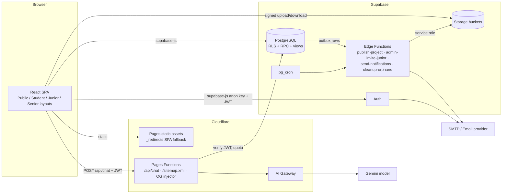

# 02 — Technical Requirements Document (TRD)
**Product:** The Inspire Business Academy Platform · **Version 1.0** · **Date:** 24 Oct 2026
Maps to `01_PRD.md` (FR/NFR/BR IDs) and uses names from `05_Backend_Schema.md` exactly. Each requirement has an ID `TR-###` and lists related PRD IDs. Code blocks are labelled **SQL (executable pattern)**, **TS (executable pattern)** or **PSEUDO**.

---

## 1. System architecture

### 1.1 Overview (TR-001 · FR-110, NFR-006)
A **single-page application** (React + TypeScript + Vite) served as static assets from **Cloudflare Pages**. It talks to **Supabase** directly with the **anon/publishable key** plus the user's JWT (all data access is governed by **RLS**). Privileged or multi-step operations run in **Postgres `SECURITY DEFINER` functions (RPC)**. Operations that need the service role or third-party APIs run in **Supabase Edge Functions** (storage copy, admin invite, email dispatch, cron jobs). The AI chatbot runs in a **Cloudflare Pages Function** that verifies the user's Supabase JWT and calls the model through **Cloudflare AI Gateway**; the AI key never reaches the browser.



### 1.2 Technology stack & rationale (TR-002 · NFR-011)
| Concern | Choice | Why / what happens to the ZIP's choice |
|---|---|---|
| UI | React 19 + TypeScript (strict) + Vite 6 | Kept from ZIP; enable `"strict": true` |
| Routing | `react-router-dom` 7, **`createBrowserRouter`** (replaces `MemoryRouter`) | Real URLs, deep links, SEO, back button (fixes D-02) |
| Styling | Tailwind CSS 4 (`@tailwindcss/vite`), `clsx`, `tailwind-merge` | Kept |
| Animation | **`motion`** only (remove duplicate `framer-motion`) | Fewer deps; respect `prefers-reduced-motion` |
| Icons | `lucide-react` | Kept; full icon map for course icons (fixes D-06) |
| Data fetching/cache | `@tanstack/react-query` v5 | Caching, retries, optimistic updates (replaces per-hook `useState` + `localStorage`) |
| Forms/validation | `react-hook-form` + `zod` (+ `@hookform/resolvers`) | One schema per form shared with API payload types |
| Backend client | `@supabase/supabase-js` v2 | Auth, PostgREST, Storage, RPC |
| Charts | `recharts` (lazy-loaded) | Admin & report charts (ZIP used CSS bars) |
| Markdown | `react-markdown` + `remark-gfm` + `rehype-sanitize` | Fixes raw Markdown (D-05); editors use textarea + preview |
| Meta/SEO | `react-helmet-async` | Titles/OG on public routes |
| Dates | `date-fns` + `date-fns-tz` | Asia/Karachi business-day logic (fixes D-13) |
| Toasts | `sonner` | Replaces `alert/confirm/prompt` (D-18); use accessible dialog for confirms |
| File ZIP export | `jszip` (kept) | Portfolio ZIP from signed URLs |
| Upload | `@supabase/supabase-js` Storage + `tus-js-client` for > 6 MB | Resumable (NFR-004) |
| Tests | `vitest`, `@testing-library/react`, `playwright`, pgTAP/SQL tests | See §12 |
| **Removed** | `@google/genai` (client), `express`, `dotenv`, `@capacitor/*`, `framer-motion`, duplicate `vite` entry, `define` of `GEMINI_API_KEY` | Security & hygiene (D-04, D-16). Capacitor: see TR-112 |
| Hosting | **Cloudflare Pages** (Workers & Pages) only | Per workflow; build `npm run build` → `dist` |
| AI | Cloudflare AI Gateway → Gemini (model name from env) | Key as Cloudflare secret |
| Email | SMTP/transactional provider via Supabase Auth SMTP + Edge Function | Decision A-11 |
| Error monitoring | Sentry (browser, optional DSN) P2 | |

### 1.3 Environments (TR-131)
`development` (local Vite + Supabase local/dev project), `staging` (Cloudflare preview deployments + separate Supabase project), `production`. Separate Supabase projects per env; never share keys; staging uses seeded fake data only.

---

## 2. Frontend architecture

### 2.1 Directory structure (TR-010 · NFR-011)
```
/ (repo root)
├─ package.json  package-lock.json (only lockfile)  .npmrc (legacy-peer-deps=true)  vite.config.ts  tsconfig.json
├─ index.html (title "The Inspire Business Academy", meta, favicon)
├─ public/ _redirects (/* /index.html 200)  robots.txt  manifest.webmanifest  icons/
├─ functions/                       # Cloudflare Pages Functions
│  ├─ api/chat.ts                   # POST /api/chat
│  ├─ sitemap.xml.ts                # dynamic sitemap
│  └─ portfolio/[slug].ts           # OG/meta injection for project pages (HTMLRewriter)
├─ supabase/
│  ├─ migrations/                   # numbered SQL (created by ChatGPT per 05_Backend_Schema.md)
│  ├─ functions/                    # Edge Functions (publish-project, admin-invite-junior, send-notifications, cleanup-orphans)
│  ├─ seed/                         # seed SQL/JSON generated from original data files
│  └─ tests/                        # pgTAP RLS tests
├─ src/
│  ├─ main.tsx  App.tsx  router.tsx
│  ├─ lib/ (supabase.ts, env.ts, dates.ts, format.ts, utils.ts(cn), constants.ts, queryClient.ts)
│  ├─ types/ (database.ts [generated], domain.ts, forms.ts)
│  ├─ services/                     # ONLY place that calls Supabase (one file per module)
│  │   auth.ts applications.ts students.ts dailyLogs.ts reports.ts targets.ts skills.ts learning.ts courses.ts
│  │   portfolio.ts projects.ts storage.ts games.ts shortcuts.ts search.ts chat.ts notifications.ts
│  │   settings.ts cms.ts admin/*.ts (applications, students, projects, reports, assignments, content, analytics, audit, exports, admins)
│  ├─ hooks/ (useAuth, useRole, usePermission, useToday, useDebounce, useUpload, queries/*.ts)
│  ├─ domain/                       # PURE business-rule functions (unit-tested): streak.ts performance.ts insights.ts weekly.ts progress.ts targets.ts
│  ├─ components/
│  │   ui/ (Button, Input, Select, Textarea, Checkbox, Switch, Modal, ConfirmDialog, Drawer, Tabs, Badge, Card, Skeleton, EmptyState, ErrorState, Pagination, ProgressBar, ProgressRing, Toast, Table, Dropdown, Tooltip, Avatar, FileDropzone, MarkdownView, MarkdownEditor)
│  │   layout/ (PublicLayout, AuthLayout, StudentLayout, AdminLayout, Topbar, Sidebar, MobileTabBar, Footer, Breadcrumbs)
│  │   shared/ (SearchBox, NotificationBell, StatCard, Chart wrappers, PermissionGate, RoleGate)
│  ├─ features/                     # screen-level modules mirroring routes
│  │   public/ auth/ application/ student/{dashboard,tasks,reports,targets,learning,courses,portfolio,projects,games,shortcuts,chatbot,search,profile,notifications,settings,assignments}/ admin/{dashboard,applications,students,projects,reports,assignments,content,cms,announcements,inquiries,admins,settings,analytics,audit,backups}/
│  ├─ data/seed/                    # original static data kept as seed sources (coursesContent.ts, learningContent.ts, shortcutsData.ts, gamesContent.ts) — used by seed generator, NOT by runtime UI
│  └─ styles/index.css
└─ tests/ (unit, component, e2e)
```

### 2.2 Routing & access control (TR-013 · FR-022, BR-04)
```ts
// router.tsx  — TS (executable pattern)
createBrowserRouter([
  { element: <PublicLayout/>, children: [ {path:'/',element:<Home/>}, {path:'/about',...}, {path:'/courses'}, {path:'/courses/:slug'}, {path:'/portfolio'}, {path:'/portfolio/:slug'},
      {path:'/students/:slug'}, {path:'/achievements'}, {path:'/skills'}, {path:'/announcements'}, {path:'/contact'}, {path:'/apply'}, {path:'/privacy'}, {path:'/terms'} ]},
  { element: <AuthLayout/>, children: [ '/login','/register','/forgot-password','/reset-password','/verify-email' ]},
  { path:'/app/application', element:<RequireRole roles={['applicant','student']}/>, ... },
  { path:'/app', element:<RequireRole roles={['student']}><StudentLayout/></RequireRole>, children:[ ...student routes ]},
  { path:'/junior', element:<RequireRole roles={['junior_admin']}><AdminLayout variant="junior"/></RequireRole>, children:[ ...routes each wrapped in <RequirePermission p="..."/> ]},
  { path:'/admin', element:<RequireRole roles={['senior_admin']}><AdminLayout variant="senior"/></RequireRole>, children:[ ... ]},
  { path:'*', element:<NotFound/> }
])
```
`RequireRole` reads `profiles.role` via `useAuth()` (fetched after session load, cached 60 s, refetched on focus). **Frontend guards are UX only**; every API call is authorised by RLS/RPC. Student gate: if `student_skills` is empty → redirect to `/app/skills` (original Splash behaviour F-01/F-02). Suspended → `/suspended`. Unauthorized → `/403`.

### 2.3 State & data layer (TR-011)
React Query keys per module (`['dailyLog', date]`, `['courses']`…). `services/*` return typed results and throw typed `AppError {code, message, details}`. Optimistic updates for daily log inputs with 400 ms debounce; mutations invalidate relevant keys; global `onError` toast. No `localStorage` for shared data (allowed only for UI prefs: theme/last tab).

### 2.4 Markdown (TR-015 · FR-054) — `MarkdownView` renders lesson `content_md` with GFM, headings styled, `rehype-sanitize` strict schema, external links `rel="noopener noreferrer"`.

### 2.5 Charts (TR-016) — `recharts` lazy chunks: 7-day earnings bar, performance ring (SVG, reuse original path trick), admin line/bar/donut.

### 2.6 Date & time rules (TR-017 · BR-05, BR-10, NFR-014)
All "today/yesterday/week/month" computed with `date-fns-tz` in `Asia/Karachi` via `lib/dates.ts` (`todayPK()`, `isoWeekStartPK(d)`, `monthStartPK(d)`); DB uses `today_pk()`. **Never** `toISOString().split('T')[0]` on local dates (original defect D-13). Weeks start Monday (ISO).

### 2.7 i18n-ready (TR-018 · FR-111) — string table `src/i18n/en.ts`, `t()` helper; Roman-Urdu seed content stays data; `dir` attribute prepared for Urdu P2. Currency `formatPKR(n)` → `Rs 1,500`.

### 2.8 Errors/offline (TR-019 · FR-114) — `ErrorBoundary` per layout, `<OfflineBanner/>`, query retry 2×, friendly messages map for Postgres/RLS codes (`42501` → "You don't have access"), toasts for mutation results.

### 2.9 Domain functions (pure, unit-tested) — TS (executable pattern)
```ts
export const isActiveDay = (l?: DailyLog, cfg = {minMsgs:10, minOrders:1}) =>
  !!l && (l.messages_sent >= cfg.minMsgs || l.orders_completed >= cfg.minOrders || l.portfolio_improved || l.topics_read > 0);

export function calcStreak(logsByDate: Record<string, DailyLog>, today: string): number {
  let s = 0, d = parse(today);
  if (isActiveDay(logsByDate[fmt(d)])) s++;          // today counts if active
  d = addDays(d, -1);
  while (isActiveDay(logsByDate[fmt(d)])) { s++; d = addDays(d, -1); }
  return s;
}
export const streakReward = (s: number) => s >= 30 ? 'Pro Level' : s >= 7 ? 'Good Consistency' : s >= 3 ? 'On Fire' : 'Keep Going';
export const performanceScore = (msgs: number, orders: number, streak: number, t = {msgs:30, orders:2}) =>
  Math.round(Math.min(1, msgs / t.msgs) * 40 + Math.min(1, orders / t.orders) * 40 + Math.min(1, streak / 7) * 20);
export const growthPct = (cur: number, prev: number) => prev === 0 ? (cur > 0 ? 100 : 0) : Math.round(((cur - prev) / prev) * 100);
export const progressColorTask = (p: number) => p >= 100 ? 'green' : p >= 50 ? 'yellow' : 'red';
export const progressColorTarget = (p: number) => p >= 80 ? 'green' : p >= 40 ? 'yellow' : 'red';
```
The same logic is mirrored in SQL (`get_student_summary`) for admin dashboards; tests assert parity.

---

## 3. Authentication & authorization architecture

### 3.1 Flows (TR-020 · FR-020–023)
Email + password via Supabase Auth; email confirmation **required** (`enable_confirmations=true`); password min 10 chars (Auth settings) + zxcvbn-style client hint; Auth rate limits enabled; CAPTCHA (Cloudflare Turnstile) on sign-up/contact (P1). Redirect URLs configured for each environment. Sign-up metadata only carries `full_name` (informational); **role is never read from metadata**. Trigger `handle_new_user` creates `profiles(role='applicant')`.

### 3.2 Roles & permissions (TR-021 · FR-097, BR-01/04) — see Backend Schema §1, §3. Client reads own role from `profiles` (RLS self-read). Admin permission list fetched from `admin_permissions` for UI gating. Authorization decisions live in `current_user_role()`, `has_permission()`, `can_access_student()` used inside RLS/RPC.

### 3.3 Senior Admin bootstrap (TR-022 · FR-097, Req 6.1)
No public path creates admins. Procedure (documented, one-time, run by owner/ChatGPT in Supabase dashboard):
1. In Supabase Dashboard → Authentication → **Add user** (email of the owner, strong password set by the owner; auto-confirm). *No password is ever written in repo/docs.*
2. In SQL editor run `select public.bootstrap_senior_admin('owner@example.com');` — **PSEUDO email shown**.
```sql
-- SQL (executable pattern)
create or replace function public.bootstrap_senior_admin(p_email citext) returns void
language plpgsql security definer set search_path=public as $$
declare uid uuid;
begin
  if exists (select 1 from profiles where role='senior_admin') then
    raise exception 'A senior admin already exists; bootstrap disabled';
  end if;
  select id into uid from auth.users where email = p_email;
  if uid is null then raise exception 'Auth user not found'; end if;
  update profiles set role='senior_admin', account_status='active' where id = uid;
  insert into audit_logs(actor_id,actor_role,action,entity_type,entity_id,meta)
    values (uid,'senior_admin','admin.bootstrap','profile',uid::text,'{}');
end $$;
revoke all on function public.bootstrap_senior_admin(citext) from public, anon, authenticated;
```
3. Enable MFA/TOTP for senior accounts (recommended P1).

### 3.4 Junior admin provisioning (TR-023 · FR-097) — Senior UI calls Edge Function `admin-invite-junior {email, full_name, permissions[], batch_ids[]}`: verifies caller is senior (JWT → profile), uses `auth.admin.inviteUserByEmail`, then calls `set_admin_role`. Junior sets own password from invite link. Deactivation = `account_status='suspended'` (+ `auth.admin.signOut`).

### 3.5 Sessions & re-auth (TR-024 · FR-022, FR-029) — JWT expiry default 1 h with refresh; `current_user_role()` returns null for suspended users, so every RLS policy fails closed even with a valid token. Sensitive actions (role change, roll correction, export all, settings, admin creation) require `reauth_at` within 10 minutes: UI prompts password; RPC verifies `auth.jwt()->>'iat'`/custom claim `amr` recent, or `reauthenticate` via Supabase `auth.reauthenticate()` nonce (P1; fallback: re-enter password → `signInWithPassword` refresh). Session-expired screen on 401.

### 3.6 Abuse prevention (TR-025) — Supabase Auth rate limits; contact/application RPC throttles (per user & `ip_hash`); Cloudflare WAF rate rule on `/api/chat`; Turnstile on public forms.

---

## 4. Database, RLS & functions

### 4.1 Migrations (TR-030 · all FR) — Create migrations in order (ChatGPT executes): `0001_extensions_enums` (`citext`, `pgcrypto`, `pg_cron`, `unaccent`), `0002_core_identity`, `0003_academy_content`, `0004_student_lifecycle`, `0005_tracking_reports`, `0006_portfolio_projects`, `0007_games_shortcuts`, `0008_notifications_cms_audit`, `0009_helpers_rpcs`, `0010_rls_policies`, `0011_views_public`, `0012_storage_buckets_policies`, `0013_triggers_cron`, `0014_seed_reference`, `0015_seed_content`. Each idempotent, reversible notes in comments. Generate `src/types/database.ts` with `supabase gen types typescript`.

### 4.2 RLS (TR-031 · AC-01–04) — Matrix in Backend Schema §7. Requirements: RLS enabled + forced on all `public` tables; `anon` has no table privileges (only `EXECUTE` on `submit_contact_inquiry` and `SELECT` on `public_*_v` views); `authenticated` privileges granted per column where needed (`profiles`, `students`); `service_role` only used by Edge Functions. Every policy has a pgTAP test (positive & negative).

### 4.3 RPC catalogue (TR-032) — Backend Schema §6. All RPCs: `SECURITY DEFINER`, `set search_path=public`, check `auth.uid()` and role/permission at the top, validate inputs, write audit when mutating admin-level data, return typed JSON. Example:
```sql
-- SQL (executable pattern) — core of FR-027 / TR-033
create or replace function decide_application(p_app uuid, p_decision text, p_note text default null, p_correction text default null)
returns jsonb language plpgsql security definer set search_path=public as $$
declare a applications%rowtype; r record; v_batch uuid;
begin
  if not (is_senior() or has_permission('applications.decide')) then raise exception 'forbidden' using errcode='42501'; end if;
  select * into a from applications where id = p_app for update;               -- row lock => idempotency
  if not found then raise exception 'not_found'; end if;
  if a.status not in ('submitted','under_review') then raise exception 'already_decided'; end if;
  if p_decision = 'approved' then
     select * into r from allocate_roll_number();                              -- locks counter row
     insert into students(profile_id,roll_number,roll_year,roll_seq,application_id,approved_by,approved_at)
       values (a.applicant_id, r.roll, r.yr, r.seq, a.id, auth.uid(), now());
     update profiles set role='student', full_name=a.full_name, phone=a.phone where id=a.applicant_id;
     insert into user_settings(profile_id) values (a.applicant_id) on conflict do nothing;
     insert into game_progress(student_id) values (a.applicant_id) on conflict do nothing;
     insert into course_enrollments(student_id,course_id,enrolled_by)
       select a.applicant_id, c.id, auth.uid() from courses c where c.status='published'
        and coalesce((select (value->>'auto_enroll_all')::bool from app_settings where key='registration'),true)
       on conflict do nothing;
     update applications set status='approved', reviewed_by=auth.uid(), reviewed_at=now(), review_note_internal=p_note where id=a.id;
     perform enqueue_notification(a.applicant_id,'application_approved','Welcome to the Academy!',
             'Your application is approved. Your roll number is '||r.roll, '/app','app_approved:'||a.id);
     perform write_audit('application.approve','application',a.id::text,null,jsonb_build_object('roll',r.roll),jsonb_build_object('note',p_note));
     return jsonb_build_object('status','approved','roll_number',r.roll);
  elsif p_decision in ('rejected','changes_requested') then
     update applications set status=p_decision::application_status, reviewed_by=auth.uid(), reviewed_at=now(),
            review_note_internal=p_note, correction_message=p_correction where id=a.id;
     perform enqueue_notification(a.applicant_id, case when p_decision='rejected' then 'application_rejected' else 'changes_requested' end,
             'Application update', coalesce(p_correction,'Please check your application status.'), '/app/application','app_'||p_decision||':'||a.id);
     perform write_audit('application.'||p_decision,'application',a.id::text,null,null,jsonb_build_object('note',p_note));
     return jsonb_build_object('status',p_decision);
  else raise exception 'invalid_decision'; end if;
end $$;
```
*Concurrency:* `allocate_roll_number()` uses `INSERT … ON CONFLICT DO UPDATE` on `roll_number_counters` which takes a row-level lock held until the approving transaction commits; if the transaction rolls back, the increment rolls back too (no gaps from failures). `unique(roll_number)` and `unique(roll_year, roll_seq)` are the safety net.

### 4.4 Roll number allocation (TR-033 · FR-027/084, BR-02) — Spec: see Backend Schema §4.3 (`allocate_roll_number`, `guard_roll_number`). Correction RPC sets `set_config('app.roll_correction','on', true)` (transaction-local), updates, writes audit with before/after. Display/search: `students.roll_number` searchable with `ilike` + trigram index; admin search accepts `2026-0012`, `IBA-2026-0012`. Migration of existing offline students: Senior-only RPC `import_existing_student(email, full_name, phone, legacy_roll default null)` allocates a new roll or accepts a supplied unused number (P1).

### 4.5 Project state machine & publication (TR-034 · FR-056/092, BR-13/14)
Trigger `guard_project_status` (BEFORE UPDATE on `projects`): non-RPC callers may only change `status` between `draft`↔`submitted` is **not** allowed either (use `submit_project`); direct updates may change content columns only while `status in ('draft','changes_requested')` (and published/approved → edit creates revision via `request_revision` RPC). RPC transitions table:
| From | To | By | RPC |
|---|---|---|---|
| draft / changes_requested | submitted | owner | `submit_project` |
| submitted | under_review | admin | `review_project(...,'start')` (optional) |
| submitted/under_review | approved / rejected / changes_requested | admin `projects.review` | `review_project` |
| approved | published | admin `projects.publish` | `publish_project` |
| published | approved | admin `projects.publish` | `unpublish_project` |
| approved/published | submitted (new revision) | owner | `request_revision` |
| any (not published) | archived | owner/admin | `archive_project` |
`publish_project` writes an **outbox** row (`storage_publish_jobs` — add table: `id, project_id, action('publish'|'unpublish'), status, attempts, created_at`) that Edge Function `publish-project` consumes (called immediately via `pg_net`/client trigger and again by cron if pending > 1 min).

### 4.6 Public views (TR-035 · FR-004–008, AC-08) — Backend Schema §5. Views created with `security_invoker=false` owned by role `public_reader` that has SELECT only on needed columns; includes `limit`-friendly indexes. Public project list API: `from('public_projects_v').select(...).order(...).range()`; search via `.textSearch('search', q, {config:'simple'})` on a `search` column exposed in the view.

### 4.7 Constraints & indexes (TR-036) — As in Backend Schema (unique, check, FK, GIN full-text indexes, `(student_id, log_date desc)` etc.). Add `pg_trgm` index on `profiles.full_name`, `students.roll_number`. `ON DELETE`: student-owned data cascades from `students` only when a Senior hard-deletes; normal withdrawal is soft (`account_status`).

### 4.8 Triggers (TR-037) — `set_updated_at`, `handle_new_user`, `guard_roll_number`, `guard_project_status`, `deny_audit_mutation`, `sync_lesson_course_id`, `enforce_report_edit_window` (blocks student UPDATE when `status='reviewed'`), `validate_portfolio_file` (extension/MIME/size vs `app_settings.upload_limits`, `public_path` immutable by owner), `check_enrollment_for_progress`.

### 4.9 Seeds (TR-038) — Supabase seed scripts convert original data files to SQL inserts with `legacy_id`; generation script `scripts/generate-seed.ts` (Node, run by ChatGPT/implementer) reads `src/data/seed/*.ts` and emits `supabase/seed/*.sql`. Counts asserted by a test (10/39/124, 8/40, 133, 8, 2, 4, 6).

---

## 5. Storage architecture (TR-050 · FR-055/056, BR-16)
Buckets and policies: Backend Schema §8. Upload lifecycle (TR-051):
1. Client validates type/size → 2. calls `storage.createSignedUploadUrl`/standard `upload` to `student-submissions/{auth.uid()}/{yyyy}/{uuid}-{safe}` (progress via TUS for > 6 MB) → 3. on success inserts `portfolio_files` row (trigger validates) → 4. on DB failure client deletes object; otherwise orphan found by cleanup job (object exists in `storage.objects` with no `portfolio_files.storage_path`, older than 24 h) → `storage_cleanup_queue`.
Delete/replace (TR-053): deleting a `portfolio_files` row (or project) triggers `AFTER DELETE` insert into `storage_cleanup_queue (bucket,path)` for `storage_path` and `public_path`; Edge Function `cleanup-orphans` (cron every 15 min) deletes objects via service role and sets `processed_at`.
Publish (TR-052): Edge Function `publish-project` — verifies job, for each `portfolio_files` of project with `media_role in ('thumbnail','gallery','video')` and image/video MIME: `storage.copy` to `public-portfolio/{project_id}/{rev}/…`, sets `public_path`, marks job done; **unpublish** deletes public copies and nulls `public_path`. Public bucket contains only published files; unpublished files are never public (AC-08).
Validation (TR-054): MIME allow-list per bucket; reject SVG/HTML/JS/exe; verify magic bytes for images in Edge Function on publish (reject mismatch); filename slugify; max files per project; thumbnail generation: client creates 800 px WebP thumbnail before upload for images (P1); Supabase image transformations optional for public delivery.
Downloads: private files via `createSignedUrl(path, 300)`; ZIP export builds client-side from signed URLs.
Quotas: per-student total size cap (default 500 MB, `app_settings.upload_limits.student_quota_mb`) enforced in `validate_portfolio_file` trigger; admin dashboard shows total storage via `storage.objects` sum.

---

## 6. API / backend interaction contracts (TR-060 · all FR)
Rule: the browser calls only (a) Supabase Auth, (b) PostgREST tables/views under RLS, (c) RPCs, (d) Storage, (e) Edge Functions via `supabase.functions.invoke`, (f) Cloudflare Functions `/api/chat`. Contracts (Auth = JWT required; R = role/permission):

| Operation | Mechanism | Auth / R | Input (validation) | Output | Errors | Audit |
|---|---|---|---|---|---|---|
| Sign up | `auth.signUp` | public | email, password ≥ 10, full_name ≤ 100 | session/pending-confirm | `user_already_registered` | — |
| Save/submit application | RPC `submit_application` / table upsert while draft | applicant | fields §PRD 9.2.1, consents true | `{status}` | `validation`, `not_verified`, `cooldown` | ✔ |
| Decide application | RPC `decide_application` | `applications.decide` | `p_app uuid, p_decision enum, p_note ≤ 1000, p_correction ≤ 500 (required for rejected/changes)` | `{status, roll_number?}` | `forbidden`, `already_decided` | ✔ |
| Correct roll number | RPC `correct_roll_number` | senior + reauth | `student_id, new_roll regex ^[A-Z]{2,6}-\d{4}-\d{4,6}$, reason ≥ 10 chars` | `{old,new}` | `duplicate`, `forbidden` | ✔ |
| Daily log upsert | RPC `upsert_daily_log` | student | numbers ≥ 0 within caps, `log_date` ∈ [today−7, today] | row | `out_of_window` | — |
| Summary | RPC `get_student_summary` | student/admin scoped | optional `student_id` | `{streak, reward, score, insights[], week{best,worst,growth,series[7]}}` | — | — |
| Submit report | RPC `submit_report` | student | `kind, period, fields` (required texts) | row | `duplicate_period`, `locked` | — |
| Review report | RPC `review_report` | `reports.review` + scope | `kind,id,status,comment` | row | `forbidden` | ✔ |
| Mark lesson complete | RPC `mark_lesson_complete` | student enrolled | `lesson_id` | `{course_pct}` | `not_enrolled` | — |
| Upload file | Storage + insert `portfolio_files` | student | see TR-051 | row | `file_too_large`, `type_not_allowed`, `quota_exceeded` | — |
| Project CRUD | tables under RLS | student | zod `projectSchema` | row | RLS | — |
| Submit/review/publish project | RPCs (TR-034) | per table | `comment` required for reject/changes | `{status}` | `invalid_transition`, `no_thumbnail` | ✔ publish/approve |
| Game result | RPC `submit_game_result` | student | `game, score, meta` | `{xp,level,high}` | `score_out_of_range` | — |
| Global search | RPC `global_search` | auth | `q ≥ 2 chars, scopes[]` | grouped results | — | — |
| Chat | `POST /api/chat` | student/admin JWT | `{message ≤ 1000, history ≤ 10}` | `{reply, mode:'ai'|'fallback', remaining}` | `429 limit`, `503 ai_unavailable` | usage row |
| Notifications | table `notifications`, RPC `mark_notifications_read`, prefs upsert | owner | | | | — |
| Settings (app) | table `app_settings` | senior | zod per key | row | | ✔ |
| Admin dashboard | RPC `admin_dashboard_metrics` | `analytics.view` | `date_from,date_to,batch_id` | KPI JSON | | — |
| Export | RPC `export_admin_dataset` | `exports.students`/senior | `kind, filters` | rows (client builds CSV) | | ✔ |
| Admin invite | Edge `admin-invite-junior` | senior + reauth | `email, full_name, permissions[], batch_ids[]` | `{profile_id}` | `already_exists` | ✔ |
| Set admin role/permissions | RPC `set_admin_role` | senior + reauth | | | `last_senior` | ✔ |
| CMS save/publish | table `site_content` / RPC `publish_site_content(key)` | `cms.edit_public` / senior | JSON per zod schema | row | | ✔ publish |
| Contact inquiry | RPC `submit_contact_inquiry` | anon | name, contact, message ≤ 4000, honeypot empty | `{ok}` | `rate_limited` | — |
| Legacy import | RPC `import_legacy_backup` | student | JSON ≤ 5 MB | `{imported:{...}, skipped:[...]}` | `invalid_format` | — |
Error envelope (client): `{ code: string, message: string, details?: any }`; Postgres exceptions raised with `errcode` mapped in `services/_errors.ts`.

TypeScript domain model excerpts (TS executable pattern):
```ts
export type Role = 'applicant'|'student'|'junior_admin'|'senior_admin';
export interface Profile { id: string; role: Role; account_status: 'active'|'suspended'|'withdrawn'; full_name: string; email: string; phone: string|null; avatar_path: string|null }
export interface Student { profile_id: string; roll_number: string; batch_id: string|null; admission_date: string; address: string|null; city: string|null; bio: string|null; public_slug: string|null; public_profile_enabled: boolean }
export interface DailyLog { id: string; student_id: string; log_date: string; messages_sent: number; orders_completed: number; assets_created: number; portfolio_improved: boolean; learning_minutes: number; clients_obtained: number; earnings: number; topics_read: number; skill_tasks_completed: Record<string, boolean> }
export type ProjectStatus = 'draft'|'submitted'|'under_review'|'changes_requested'|'rejected'|'approved'|'published'|'archived';
```

### 6.1 Edge Functions (TR-061)
| Function | Trigger | Purpose | Secrets |
|---|---|---|---|
| `publish-project` | HTTP (from client after `publish_project`) + cron retry | Copy/remove public media (TR-052) | service role (auto) |
| `admin-invite-junior` | HTTP (senior JWT) | Invite user + `set_admin_role` | service role |
| `send-notifications` | cron every 1 min | Process `notification_deliveries` (email; push P2), retries with backoff (1,5,15,60 min; max 5), set `status`/`provider_message_id` | `EMAIL_API_KEY`, `EMAIL_FROM` |
| `cleanup-orphans` | cron 15 min | Process `storage_cleanup_queue`, find orphan objects | service role |
| `daily-reminders` | cron every 5 min | For users whose `daily_reminder_time` ≤ now (PKT) and no log today and not already sent (`dedupe_key`), enqueue `daily_reminder` | — |
| `backup-export` (P1) | HTTP (senior) | Streams JSON export of selected tables to `admin-documents`, records `backup_runs` | service role |

### 6.2 Cloudflare Pages Functions (TR-062)
`functions/api/chat.ts` (TR-080), `functions/sitemap.xml.ts` (reads `public_projects_v`, `public_courses_v`, static routes using anon key), `functions/portfolio/[slug].ts` (fetch project from `public_projects_v`, rewrite `<title>`, `og:*` tags via `HTMLRewriter`, fall back to SPA `index.html`).

---

## 7. Notifications (TR-070 · FR-028, FR-066, FR-102)
Pipeline: event (RPC/trigger) → `enqueue_notification()` inserts `notifications` (deduped by `dedupe_key`) and one `notification_deliveries` row per channel enabled in `notification_preferences` (default: in_app on; email on for application/project/assignment/security types; push off). **In-app** is delivered when row exists *and* Supabase Realtime subscription (or 60 s polling) shows it — the bell reads `notifications` directly. **Email** (TR-071): `send-notifications` sends via provider API, sets `sent` then `delivered` only if provider webhook confirms (P2), else stays `sent`; failures → `failed` with `last_error` and retry schedule; UI never says "delivered" without status. Auth emails (verify/reset/invite) use Supabase Auth SMTP configured with the same provider; HTML templates branded. **Reminders** (TR-072): replaces Capacitor LocalNotifications; per-user time (`user_settings.daily_reminder_time`, default 20:00 PKT), skip if daily log exists, message default: "30 messages bheje? Aaj ka report fill karo!". Browser push (P2) via Web Push + service worker — optional, never required. Privacy: notification bodies contain no sensitive data beyond what the recipient owns.

---

## 8. Chatbot / AI (TR-080 – TR-083 · FR-065, BR-17, NFR-007)
**Request flow:** SPA `POST /api/chat` with `Authorization: Bearer <supabase access token>` → Pages Function verifies token (`supabase.auth.getUser(token)` with anon key), loads `profiles` & `app_settings.chatbot` (through the user's own JWT client so RLS applies), checks `enabled`, role ≠ applicant, daily quota (`count(*) from chatbot_usage where student_id=… and created_at >= start_of_day_pk`), message length; builds **grounding context** via RPC `chat_context(q)` (top ≤ 3 snippets from lessons/learning_subsections/shortcuts using full-text search, ≤ 300 chars each — mirrors original `getLocalContext`); calls AI Gateway; inserts `chatbot_usage` (no message text); returns `{reply, remaining}`. Fallback (AI error/timeout 20 s/disabled): returns local snippets or "I couldn't find…" message with `mode:'fallback'` (matches original offline mode).
```ts
// functions/api/chat.ts — TS (executable pattern, abbreviated)
export const onRequestPost: PagesFunction<Env> = async ({ request, env }) => {
  const token = request.headers.get('Authorization')?.replace('Bearer ','');
  if (!token) return json({code:'unauthorized'}, 401);
  const sb = createClient(env.SUPABASE_URL, env.SUPABASE_ANON_KEY, { global: { headers: { Authorization: `Bearer ${token}` } } });
  const { data: { user } } = await sb.auth.getUser(token); if (!user) return json({code:'unauthorized'}, 401);
  const body = await request.json(); const msg = String(body.message ?? '').slice(0, 1000);
  const { data: gate } = await sb.rpc('chat_gate');          // returns {allowed, remaining, enabled}
  if (!gate?.allowed) return json({code:'limit', remaining: 0}, 429);
  const { data: ctx } = await sb.rpc('chat_context', { q: msg });
  const prompt = buildPrompt(ctx, (body.history ?? []).slice(-10), msg);   // PSEUDO helper
  const res = await fetch(`${env.AI_GATEWAY_BASE_URL}/google-ai-studio/v1beta/models/${env.AI_MODEL}:generateContent`, {
    method:'POST', headers:{ 'Content-Type':'application/json', 'x-goog-api-key': env.GEMINI_API_KEY, ...(env.AI_GATEWAY_TOKEN ? {'cf-aig-authorization': `Bearer ${env.AI_GATEWAY_TOKEN}`} : {}) },
    body: JSON.stringify({ contents:[{ role:'user', parts:[{ text: prompt }]}] }), signal: AbortSignal.timeout(20000) });
  /* map result, insert chatbot_usage via sb.rpc('chat_log', {...}), return {reply, remaining, mode:'ai'} */
};
```
> The exact AI Gateway URL/headers must be confirmed with Cloudflare's official docs/support chatbot (workflow Section 7) before implementation; the snippet above is a **PSEUDO-level outline**, not verified Cloudflare syntax.
Provider abstraction: `AI_PROVIDER` env (`gemini` default) behind `callModel()` so swap is one file. Safety: system prompt restricts to academy learning topics, refuses harmful requests, no personal data of other students is ever put in context. Logging: only metering (TR-082); retention 90 days (cron delete). The model default is whatever `AI_MODEL` is (original used `gemini-3-flash-preview`, a preview model → configure and re-test periodically).

---

## 9. Search, analytics, audit, exports

### 9.1 Search (TR-090 · FR-064, NFR-003) — Postgres FTS (`'simple'` config because content mixes English and Roman Urdu) via generated `tsvector` columns + `pg_trgm` for names/roll numbers; RPC `global_search` returns `{type,id,title,snippet,url}` max 10 per type, role-aware (student sees: published courses/lessons, learning, shortcuts, own logs by date/own reports/own files; admin sees: students (scoped), projects, applications, inquiries per permission). Public search is only on `public_projects_v`. Minimum 2 chars; client debounce.

### 9.2 Dashboard metrics (TR-091 · FR-080/081, AC-20) — RPC `admin_dashboard_metrics(date_from,date_to,batch_id)` returns JSON; formulas: *Active students* = students with ≥ 1 `daily_logs` in range; *Daily-log completion* = logs-with-all-core-targets-met ÷ (active students × days); *Report submission rate* = submitted reports ÷ expected (students × periods); *Learning progress* = avg(completed lessons ÷ total lessons); *Projects awaiting review* = status in (submitted, under_review). Junior: restricted to `admin_batch_access` batches by joining through `can_access_student`. Freshness: computed on request (no cache) up to 5,000 students; materialised view refreshed every 15 min if p95 > 1.5 s.

### 9.3 Audit logging (TR-092 · FR-100/115, BR-18) — Function `write_audit(action, entity_type, entity_id, before, after, meta)` (SECURITY DEFINER; captures `auth.uid()`, role; IP/User-agent captured only in Edge/Pages paths and passed in meta). Events: application decisions, roll allocate/correct, role/permission changes, suspend/reactivate, project approve/reject/publish/unpublish/feature, CMS publish, settings change, exports, deletions, bootstrap, failed privileged attempts (P2). Immutable: no UPDATE/DELETE policies, trigger blocks mutation, backups keep copies.

### 9.4 Exports & backups (TR-093 · FR-068/099/101) — Student: `export_my_data()` → JSON download. Admin: `export_admin_dataset` → CSV (client generated; UTF-8 BOM for Excel); columns minimised; each call audited; row cap 10,000 per export. **Local backup/restore of shared data is deliberately removed**; `restore` for students = legacy import only.

---

## 10. Security, privacy, performance

### 10.1 Threat model (TR-100 · NFR-007)
| Threat | Vector | Control |
|---|---|---|
| Privilege escalation | Student edits `profiles.role` / metadata | Column grants, RLS, role only from `profiles`, trigger tests (AC-04) |
| Horizontal data access | Reading others' logs/files | RLS `student_id=auth.uid()`; storage folder policy; tests AC-03 |
| Roll-number tampering/dupes | Client counters, races | Server allocation, locking, unique constraints, immutability trigger |
| Public leak of unpublished work | Guessable URLs, bucket public | Private originals; public copies only on publish; unique UUID paths; views whitelist |
| Malicious uploads | HTML/SVG/EXE, polyglot | Allow-list MIME, magic-byte check, no SVG, no inline rendering of user HTML, `Content-Disposition: attachment` for docs, separate domain for storage |
| XSS | Markdown, project text, names | `rehype-sanitize`, React escaping, CSP, no `dangerouslySetInnerHTML` except sanitised |
| CSRF | Cookie auth | Supabase uses Bearer tokens in storage → no cookie CSRF; Pages Function requires Bearer |
| Secrets exposure | Keys in bundle/repo | TR-101 |
| AI abuse / cost | Spam prompts, prompt injection | Auth, quotas, length caps, system prompt, AI Gateway rate limiting & caching, no tool access, no PII in context |
| Brute force / enumeration | Login, signup | Auth rate limits, Turnstile, generic errors |
| Admin account takeover | Phished owner | MFA, re-auth for sensitive ops, audit alerts |
| Insider misuse (Junior) | Excess data reads | Permissions + batch scope + audit + export gating |
| SQL injection | RPC dynamic SQL | No dynamic SQL; parameterised only |
| DoS via search/exports | Heavy queries | Pagination, row caps, indexes, statement timeout 10 s for `authenticated` |

### 10.2 Secrets & environment (TR-101 · AC-15) — see §13 variable list. Rules: only `VITE_SUPABASE_URL` and `VITE_SUPABASE_ANON_KEY` (publishable) reach the browser; service-role key only inside Supabase Edge runtime; `GEMINI_API_KEY`, `AI_GATEWAY_TOKEN`, `EMAIL_API_KEY` only as Cloudflare/Supabase secrets; `.env*` git-ignored (kept); CI step greps build output for `service_role`, `AIza`, `sk-`.

### 10.3 Privacy & retention (TR-102 · NFR-008, A-10) — data minimisation per PRD §9.2.1; public views whitelist; consent timestamps; retention jobs (`pg_cron`): chatbot_usage 90 d, contact_inquiries 12 mo, notifications read > 6 mo, withdrawn-student PII purge after 24 mo (manual Senior-approved job P2); data export & deletion request workflow (creates inquiry-type ticket; Senior executes `delete_student_data(student_id)` RPC that anonymises profile, deletes files, keeps audit).

### 10.4 HTTP security headers (TR-103) — `public/_headers` (Cloudflare Pages): `Content-Security-Policy` (default-src 'self'; connect-src 'self' https://*.supabase.co wss://*.supabase.co; img-src 'self' data: blob: https://*.supabase.co; media-src 'self' blob: https://*.supabase.co; script-src 'self'; style-src 'self' 'unsafe-inline' https://fonts.googleapis.com; font-src https://fonts.gstatic.com), `X-Content-Type-Options: nosniff`, `Referrer-Policy: strict-origin-when-cross-origin`, `Permissions-Policy`, `X-Frame-Options: DENY` (or frame-ancestors). Private routes `X-Robots-Tag: noindex` via `_headers` for `/app/*`, `/admin/*`, `/junior/*`.

### 10.5 Performance & caching (TR-104 · NFR-001/002/005) — route-level `React.lazy` (games, charts, admin, markdown editor separate chunks); React Query `staleTime` 60 s (public lists 5 min); image `loading="lazy"`, `srcset`, WebP; Supabase image transformation for thumbnails; Cloudflare caches static assets (immutable hashed files) and public API-backed pages briefly via Pages Function cache headers; DB indexes per schema; `select` only needed columns; list pagination `.range()`; `EXPLAIN` review of dashboard RPCs before launch.

---

## 11. Data migration (TR-110 – TR-112 · Req 18)
| Source | Strategy |
|---|---|
| `coursesContent.ts` (10 courses/39 chapters/124 topics) | **Imported as seed** → `courses/course_modules/lessons` (`legacy_id`), content Markdown unchanged |
| `learningContent.ts` (8/40) | Seed → `learning_sections/learning_subsections` |
| `shortcutsData.ts` (133) | Seed → `shortcuts` |
| `gamesContent.ts` | Seed → `quiz_questions` (8), `puzzle_workflows` (2), `memory_pairs` (4) |
| Skills constants + SKILL_TASKS | Seed → `skills` |
| Hard-coded targets | Seed → `target_definitions` (global) |
| Static academy info (owner, phone, address, tagline) | Seed → `site_content['contact.info']`, `['brand']` |
| Logo (postimg URL) | Download once, upload to `site-media`, use `/images/logo` from Pages `public/`; images workflow handles final assets |
| **User data in browsers** (`inspire_*` localStorage, IndexedDB files) | **Cannot be recovered from the ZIP.** Each student must (a) open the old app → Settings → "Save JSON" backup, (b) import it in new portal (TR-111). Portfolio **files were never in the backup**; students re-upload (old app: "Export Portfolio ZIP" first). Profile, course progress and game progress were not in the old backup (D-07) → not importable; document this to students. |
| Android app | See TR-112 |
**Legacy import (TR-111 · FR-068, AC-18):** input = file selected by student; client parses and sends to RPC `import_legacy_backup` after schema check (`appName==='InspireBusinessAcademy'`, `version===1`). Mapping: `inspire_tasks` (object date→DailyTaskEntity) → `daily_logs` (`on conflict (student_id,log_date) do nothing`, dates > today rejected); `inspire_daily_reports` (id=date) → `daily_reports`; `inspire_weekly_reports` (id `YYYY-Wn`) → `weekly_reports` with `week_start` best-effort computed from year & week (flagged `imported`) ; `inspire_monthly_reports` (`YYYY-MM`) → `monthly_reports`; `inspire_learning_progress` (sectionId `secN` → `learning_sections.legacy_id`) → `learning_progress`; `inspire_skills` (names) → `student_skills`. Output = counts imported/skipped with reasons. Validation: size ≤ 5 MB, ≤ 800 rows per table, numeric bounds, text length caps; transaction-wrapped, idempotent; rollback on exception; dry-run mode returns the report without writing.
**Android/Capacitor decision (TR-112 · FR-113):** The web platform replaces the mobile-style app. Capacitor and `android/` folder are **not carried into the new repo** at launch (generated bundle is obsolete and contains the old local-only logic). Local-notification behaviour is replaced by server notifications (TR-072). If a store app is wanted later (P2), wrap the production web build with Capacitor (`webDir: dist`, server URL or bundled), keep `appId com.inspire.academy`, and add push notifications via FCM; the old `READ/WRITE_EXTERNAL_STORAGE` permissions are unnecessary on modern Android (use file picker).

---

## 12. Testing architecture (TR-120 – TR-122 · Req 20)
| Layer | Tooling | Scope |
|---|---|---|
| Unit | Vitest | `domain/*` (streak, score, insights, weekly growth, progress, dates), validators (zod), formatters — include Karachi midnight boundary cases (23:55/00:05), Sunday week, month rollover |
| Component | Testing Library | forms (required fields), daily log inputs, Markdown render/sanitise, PermissionGate |
| DB / RLS | pgTAP or SQL scripts via `supabase test db` | For each policy: anon, applicant, student A/B, junior (with/without permission & batch), senior — expected allow/deny; roll-number concurrency test (parallel `decide_application`), immutability triggers, project state machine, audit immutability, public views leak test |
| Storage policy | SQL + integration script with real JWTs | owner read/write, other-student denied, public bucket only published |
| API/integration | Vitest + Supabase local | RPC contracts, error codes |
| E2E | Playwright (Chromium + WebKit mobile viewport) | register→verify (mock inbox)→apply→approve→login→skills→log→report→upload→project submit→review→publish→public page; admin permission variants |
| Accessibility | `axe-core` in Playwright, manual keyboard/screen-reader pass | all main pages |
| Performance | Lighthouse CI, k6 light load (50 concurrent) on RPCs | NFR-001/002 |
| Security | secret-scan in CI, dependency audit, manual abuse tests | NFR-007 |
| Migration | Seed count assertions; legacy import fixtures (valid, corrupt, duplicate) | AC-18 |
| Backup/restore | Quarterly drill: restore to staging, run smoke suite | NFR-006 |
Test case IDs referenced in PRD matrix: T-UI-*, T-DB-*, T-BR-*, T-E2E-*, T-ST-*, T-RLS-*, T-SR-*, T-NT-*, T-CMS-*, T-CI-*, T-DOC-*. The 18 scenarios in the master prompt §20 are each implemented as a named test (see `06_Implementation_Plan.md` §QA checklist).

---

## 13. Environment variables (complete list) (TR-004 · TR-131)
| Variable | Where | Secret? | Purpose / source |
|---|---|---|---|
| `VITE_SUPABASE_URL` | Cloudflare Pages build env + `.env.local` | No | Supabase Project URL (Project Settings → API) |
| `VITE_SUPABASE_ANON_KEY` | same | No (publishable) | Anon/publishable key; RLS protects data |
| `VITE_SITE_URL` | same | No | Canonical origin (OG tags, auth redirect) |
| `VITE_APP_NAME` | same | No | "The Inspire Business Academy" |
| `VITE_TURNSTILE_SITE_KEY` | same | No | Cloudflare Turnstile (P1) |
| `VITE_SENTRY_DSN` | same | No | optional (P2) |
| `SUPABASE_URL` | Cloudflare Pages Functions env | No | Used in `/api/chat`, sitemap |
| `SUPABASE_ANON_KEY` | Cloudflare Pages Functions env | No | Same anon key |
| `GEMINI_API_KEY` | Cloudflare Pages **secret** | **Yes** | AI provider key |
| `AI_GATEWAY_BASE_URL` | Cloudflare env | No | AI Gateway endpoint (account/gateway ids) |
| `AI_GATEWAY_TOKEN` | Cloudflare secret | **Yes** (if gateway auth enabled) | Gateway authentication |
| `AI_MODEL` | Cloudflare env | No | e.g. current Gemini Flash model name |
| `AI_PROVIDER` | Cloudflare env | No | `gemini` |
| `SUPABASE_SERVICE_ROLE_KEY` | **Supabase Edge Function secrets only** | **Yes** | Never in Cloudflare Pages build, never in repo |
| `EMAIL_API_KEY`, `EMAIL_FROM` | Supabase Edge secrets | **Yes** / No | Email provider (A-11) |
| `SITE_URL` | Supabase Auth config | No | Redirect base |
`.env.example` (committed) lists names with placeholder values only (e.g. `VITE_SUPABASE_URL="https://YOUR-PROJECT.supabase.co"`). **Do not commit real values.** Vite variables are build-time: set them in Cloudflare **before** deploy.

---

## 14. Deployment on Cloudflare (TR-130 · Req 21)
Build settings: Framework preset *None/Vite*; **Build command `npm run build`**; **Output directory `dist`**; Node ≥ 20 (set `NODE_VERSION=20` env); `public/_redirects` containing `/* /index.html 200` (SPA fallback; Pages Functions routes take precedence); repository must contain **only `package-lock.json`** (delete `bun.lock`/`bun.lockb`) and **`.npmrc`** with exactly `legacy-peer-deps=true`. Pre-deploy checklist (build-fail prevention): lockfile consistent (`npm ci` passes) · `npm run build` & `npm run lint` pass locally · `package.json` has `build: "vite build"` and no `express/dotenv` · env variables set · `_redirects` present · Functions compile (`wrangler pages functions build` or Pages build log) · no Node-only APIs in Functions. CI (GitHub Actions optional) runs lint, typecheck, unit, secret-scan; PR previews on Cloudflare; production deploy on merge to `main`. Rollback: Cloudflare "Rollback to previous deployment"; DB migrations additive; destructive migrations require explicit owner approval and backup first.

## 15. Backup, recovery, monitoring (TR-132/133 · NFR-006/012)
Supabase: enable daily backups (plan-dependent) and **PITR** if available; weekly logical export via `backup-export` to `admin-documents` + Storage manifest (list of paths+sizes+checksums); restore drill quarterly into staging; document RPO ≤ 24 h/RTO ≤ 4 h. Monitoring: Supabase logs/advisors, Cloudflare Web Analytics & Pages build notifications, uptime ping on `/` and an RPC health check (`select 1`), error alerts email to owner. Incident response: severity table (S1 data leak: disable public views & revoke tokens `auth.admin.signOut` for scope, rotate keys, notify owner, audit review; S2 outage: status message banner via `site_content`), post-mortem template in `docs/`.

## 16. SEO (TR-134 · FR-013) — `react-helmet-async` per route; `public/robots.txt` (`Disallow: /app /admin /junior`; sitemap URL); Pages Function `/sitemap.xml`; OG injection function for project pages; canonical `<link>` using `VITE_SITE_URL`; JSON-LD on home & project pages; private routes `noindex`.

## 17. Implementation phases & dependencies (TR-140)
(Authoritative internal build order in `06_Implementation_Plan.md`.) Foundation (repo clean-up, design system, layouts, Supabase client, auth) → student lifecycle (registration/approval UI + RPC contracts) → public site & portfolio → migrated student modules → admin panels → hardening. Dependencies: Backend Schema names frozen before service layer; Supabase project + migrations before E2E; Cloudflare envs before deploy; email provider before email notifications.

## 18. Technical acceptance criteria (TR-141)
(1) `npm ci && npm run lint && npm run build` succeed; `dist` produced. (2) Bundle scan: no secrets. (3) RLS tests: 100 % pass incl. negative cases. (4) 20 parallel approvals → 20 unique roll numbers. (5) Public views leak test: no private fields/unpublished rows. (6) Lighthouse thresholds. (7) Upload limits enforced. (8) Chat rate limit works; AI failure falls back. (9) Seed counts match. (10) Legacy import idempotent. (11) Audit entries exist for all listed events. (12) Backup export + restore drill documented. (13) All routes in PRD §18 exist with correct guards.

## 19. Technical risks & mitigations (TR-142)
| Risk | Mitigation |
|---|---|
| AI Studio generates code that diverges from schema | Exact names in `05`; Pass 2 compare; ChatGPT verifies against repo and fixes via PR |
| RLS mistakes (silent over-exposure) | pgTAP negative tests; public views only for anon; security advisor run; review before launch |
| SECURITY DEFINER functions misuse | Fixed `search_path`, revoke from `public`, explicit `auth.uid()` checks, tests |
| Supabase free-tier limits (storage, email, pausing) | Quotas config, custom SMTP, upgrade plan before launch; monitor |
| Cloudflare Functions vs Node APIs | Use Web-standard APIs only; test with `wrangler` |
| AI Gateway syntax unknown | Verify with Cloudflare docs before coding; keep behind `callModel()` |
| Large lesson content slows UI | Per-lesson fetch (not entire course content); list queries exclude `content_md` |
| Timezone bugs | Central date utils + DB `today_pk()`; boundary tests |
| Orphan files cost | Cleanup queue + monthly storage audit |
| Over-scoped single-pass build | Internal build order, P0 first, Pass 2 completion, small targeted fix messages |
