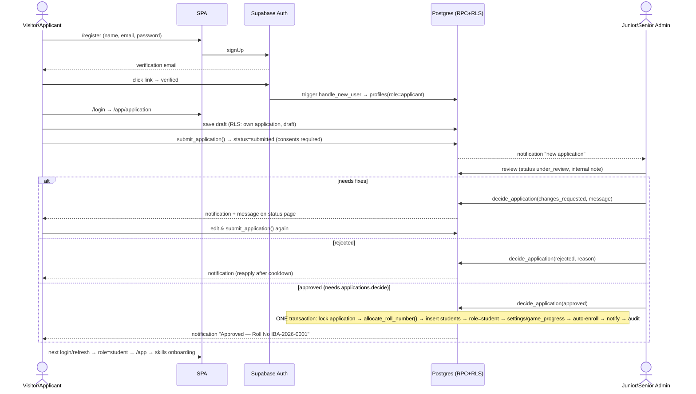
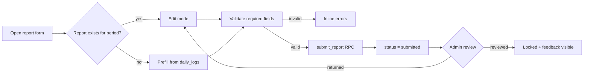
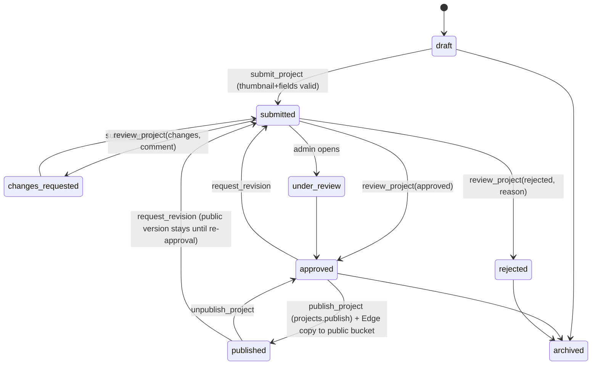

# 03 — App Flow (User & Admin Experience)
**Product:** The Inspire Business Academy Platform · v1.0 · Routes, tables, RPC names match `01_PRD.md` §18 and `05_Backend_Schema.md`.

> Legend: **→** navigation · **[Button]** action · `rpc_name()` backend operation · **State** = loading (skeleton) / empty / error / success. Every list screen implements: *loading skeleton → empty state with CTA → error state with Retry → data*. Every mutating form implements: *client validation (zod) → disabled submit while pending → success toast → error toast + inline field errors*. Destructive actions always open a `ConfirmDialog` (no `window.confirm/prompt/alert`).

---

## 1. Global navigation model

| Context | Layout | Navigation |
|---|---|---|
| Public | `PublicLayout` | Top bar: Logo · Home · About · Courses · Portfolio · Skills · Achievements · Contact · **[Login]** · **[Apply Now]** (yellow). Mobile: hamburger drawer. Footer: contact info, links (Privacy, Terms), social/WhatsApp. |
| Auth | `AuthLayout` (centered card + brand panel) | Login ⇄ Register ⇄ Forgot password |
| Applicant | Minimal header (logo, status chip, [Logout]) | `/app/application` only |
| Student | `StudentLayout` | **Desktop:** left sidebar — Dashboard, Daily Tasks, Assignments, Reports, Targets, Learning Guide, Courses, Portfolio, Games, Shortcuts, AI Assistant; top bar — global search (`Ctrl/⌘+K`), notification bell, avatar menu (Profile, Settings, Help, Logout). **Mobile:** bottom tab bar (Home, Tasks, Reports, Portfolio, More) + "More" sheet listing the rest (preserves all 9 original items). |
| Junior Admin | `AdminLayout variant=junior` | Sidebar items appear only when the permission exists (see §6) |
| Senior Admin | `AdminLayout variant=senior` | Sidebar: Dashboard, Applications, Students, Projects, Reports, Assignments, Content (Courses/Learning/Games/Shortcuts/Skills/Targets), Website CMS, Announcements, Inquiries, Admins & Permissions, Analytics & Exports, Audit Log, Backups, Settings |

Route protection outcome matrix: anonymous → `/login?next=…` · applicant opening `/app/*` (except application) → `/app/application` · student opening `/admin` → `/403` · junior opening senior-only route → `/403` · suspended → `/suspended` · unknown → 404.

---

## 2. Authentication & account flows

### 2.1 Registration → Approval → Roll number (master workflow)

Distinctions (as required): **applicant record** (`applications`) ≠ **auth account** (`auth.users` + `profiles`) ≠ **student record** (`students`, exists only after approval). Roll number is assigned **only** at approval, never on submit or by the student.

### 2.2 Screens
| Screen | Route | Fields / actions | States & messages |
|---|---|---|---|
| Register | `/register` | Full name, Email, Password (≥ 10, strength meter), Confirm, ☐ Terms & Privacy, (Turnstile) → **[Create account]** | Success: "Check your email to verify" (resend with 60 s cooldown). Errors: email exists → "Already registered — Login or Reset password"; weak password; network. |
| Verify email | `/verify-email` | Handles redirect token; **[Resend]** | Verified → "Email verified — continue to Login". Expired → resend. |
| Login | `/login` | Email, Password, [Login], links: Forgot password, Register | Wrong creds → generic "Email or password incorrect". Unverified → prompt resend. Suspended → `/suspended`. After success redirect by role (applicant→`/app/application`; student→`/app` (or `/app/skills` if none); junior→`/junior`; senior→`/admin`) or `next`. |
| Forgot / Reset password | `/forgot-password`, `/reset-password` | Email → link → new password ×2 | Always show "If the email exists, a link was sent". Expired link state. |
| Session expired | modal/`/login?expired=1` | "Session expired" + [Sign in] | Preserves `next` |
| Suspended | `/suspended` | Message + WhatsApp/phone from `contact.info` + [Logout] | |

### 2.3 Application (applicant) `/app/application`
Wizard with autosave (draft every 2 s after change): **Step 1 Personal** (full name, phone/WhatsApp, city, address optional, date of birth optional → if < 18 shows guardian fields required) · **Step 2 Learning** (preferred course, skills of interest ≥ 1, experience level, education) · **Step 3 About** (background, how heard) · **Step 4 Consent & Review** (Terms ☑, Privacy ☑, read-only summary) → **[Submit application]** (`submit_application()`).
Status page cards by `applications.status`: `draft` "Continue your application" · `submitted/under_review` "Pending review — we usually reply within 2 working days" (read-only summary, [Withdraw]) · `changes_requested` shows `correction_message` + [Edit & resubmit] · `approved` → auto-redirect to `/app` · `rejected` shows reason (public-safe text) and "You can apply again after <date>" · `withdrawn` [Re-open].
Validation: required fields per PRD §9.2.1; phone regex `^(\+92|0)3\d{9}$` (Pakistan mobile) with soft warning for other formats; message length caps.

---

## 3. Student experience (all `/app/*`; role = student)

### 3.1 First login onboarding
Login → `/app/skills` if `student_skills` empty. **Skills selection** (original F-02): 6 cards (Graphic Designing, Video Editing, Digital Marketing, AI Content, Dropshipping, Account Selling), multi-select, **[Save & Continue]** disabled until ≥ 1 → `student_skills` upsert → `/app`. Skills editable later at `/app/skills`.

### 3.2 Dashboard `/app`
Header: academy logo + "Welcome, {first name}" + roll-number chip + streak flame badge with reward label (`get_student_summary`). Banner: **daily reminder** (if today's log incomplete: "30 messages bheje? Aaj ka report fill karo!" with [Open Tasks]) — replaces the original toast. Widgets: today's progress rings (messages/orders/assets/learning), performance score ring, up to 3 insight cards, unread announcements, active assignments due soon, course progress summary, quick-tile grid (Daily Tasks, Reports, Portfolio, Targets, Learning Guide, Courses, Games, Shortcuts, AI Assistant, Assignments). States: skeleton; if API fails each widget shows its own error + retry.

### 3.3 Daily Tasks `/app/tasks` (original F-06)
Date switcher (today default; previous 7 days editable). Sections: **Core Targets** — number inputs with `/target` denominators and colour bars: Send Messages (30), Complete Orders (2), Create Assets (5), Learning (Mins) (60); **Business Growth** — New Clients (1), Earnings (Rs); **Action Items** — toggle "Improve Portfolio"; one toggle per selected skill with its daily task text (e.g. "[Graphic Designing] Create 1 design asset"). Smart banners: all core done → "Amazing work! You've hit your core daily targets." Else red "Increase Outreach — below the 30 messages target" when messages < target; yellow "Focus on Conversion" when orders = 0. Autosave (debounced 400 ms, "Saved ✓" indicator, offline → "Will save when online" queue). Links: [Write today's report], [History]. History `/app/tasks/history`: list/calendar of logs with active-day marker and streak.
Error cases: invalid number (negative, > cap) inline; date outside 7-day window disabled.

### 3.4 Reports
- **Hub `/app/reports`**: performance score ring (+ tooltip formula), Smart Insights list, Weekly Summary (best day, growth %, 7-day earnings chart), **Create Report** cards (Daily/Weekly/Monthly) showing "Done ✓" if exists for current period, [History].
- **Daily `/app/reports/daily`**: prefilled from today's log; metrics (Messages Sent, Replies Received, Orders Taken, Orders Completed, Earnings (Rs), New Accounts, New Clients); "Yesterday's Problem" reminder box; textareas **Problems Faced\*** and **Next Day Plan\***; [Save Report] disabled until required filled; if report exists → edit mode (if not reviewed).
- **Weekly `/app/reports/weekly`**: header "2026-W43 · 19–25 Oct"; auto-calculated totals (messages, orders, clients, earnings) read-only; Best Working Service select; **Weak Point\***, **Next Week Goal\***.
- **Monthly `/app/reports/monthly`**: auto totals; Top 3 Services; **Biggest Achievement\***; Biggest Mistake; **Next Month Target\***.
- **History `/app/reports/history`**: chips All/Daily/Weekly/Monthly + date range; cards with title, key earning, status badge (Submitted / Reviewed / Returned) and reviewer comment preview; tap → detail `/app/reports/:type/:id`; [Edit] (if not reviewed) / [Delete] with confirm (only if not reviewed). Returned reports show banner "Your mentor asked for changes" + [Edit & resubmit].


### 3.5 Targets `/app/targets`
Three sections — **Daily Progress**, **Weekly Summary**, **Monthly Milestones** — progress cards (title, icon, %, bar, "x of Rs y") using effective `target_definitions` (student→batch→global). Colour thresholds ≥ 80 green / ≥ 40 yellow / else red. Completed targets show 🏆. Empty if no targets: "Your mentor hasn't set targets yet" (defaults seeded so rarely empty).

### 3.6 Learning Guide `/app/learning` & Courses
- **Learning Guide**: header with overall % bar; search box; section accordions (icon, title, category, read ✓, bookmark); expanded content shows subsections; [Mark as Read/Unread] and bookmark toggle; filter "Bookmarked". Empty search: "No topics found matching “…”".
- **Courses `/app/courses`**: course cards with icon/colour, description, progress bar %, completion tick. **Course detail `/app/courses/:slug`**: header (colour, "x of y topics completed"); module accordions (n/m lessons, ✓ when all done); lesson rows (✓/○). **Lesson view `/app/courses/:slug/:lessonId`**: Markdown article, [Mark as Read] → `mark_lesson_complete()` → progress toast + auto-open next lesson; Prev/Next; breadcrumbs; "lesson search in this course". Reaching the end → "Course completed 🎉".

### 3.7 Portfolio & projects
**Portfolio `/app/portfolio`** (private workspace, replaces IndexedDB): tabs **Client Showcase** | **Practice Lab**; grid/list toggle; search (name/tag); skill filter; storage used "x MB of 500 MB"; floating **[+ Upload]**.
- **Upload modal**: choose file (drag-drop/camera on mobile) → shows type/size check → fields: Skill category, Tag (optional), File name, Description → [Upload] with progress bar, retry, cancel. Errors: too large/type not allowed/quota exceeded. Success → card appears; if Practice Lab → today's "Improve Portfolio" ticked (toast).
- **File card actions**: Preview (modal: image/video/audio/PDF viewer; others → [Download]), Edit details (inline modal: rename, description, tag, skill), Move to other collection, [Add to project] (Showcase only), Delete (confirm).
- **Projects `/app/portfolio/projects`**: list with status badges (Draft, Submitted, Under review, Changes requested, Rejected, Approved, Published, Archived). **[New project]** → `/app/portfolio/projects/new` form: Title*, Summary* (≤ 300), Description* (Markdown + preview), Category*, Skill, Tags (chips), Tools used (chips), Live URL, Repository URL (validated https), Thumbnail* (pick from files or upload), Gallery files (reorder), ☐ show my name publicly, ☐ show client name (+ client name), ☐ "I confirm I have the right to display this work" (required). Buttons: [Save draft], [Submit for review].
- **Project detail `/app/portfolio/projects/:id`**: status timeline (`project_reviews` history with comments), edit (allowed in draft/changes_requested; if approved/published → [Request revision] creates new revision), [Archive], [Delete draft], public link if published (copy/share).


### 3.8 Games `/app/games`
Hub: Player Level, XP bar (xp % 100), 5 game cards with best score and last played. Each game: HUD (score/HP/moves), pause/quit confirm ("Progress will be saved"), result screen (score, XP gained, new best 🎉, [Play again], [Back]).
- **Quiz Battle** `/app/games/quiz`: player vs enemy HP 100; question + options; correct: "Direct Hit! −25 Enemy HP" (+10); wrong: "Wrong! You took 20 damage."; enemy defeated: +50 bonus & next enemy; ends at player HP 0 **or** quit → `submit_game_result('quiz', score)`.
- **Puzzle Challenge** `/app/games/puzzle`: drag/keyboard-reorder steps (a11y: up/down buttons); [Check Answer]; correct +100, next level; finish +100 bonus.
- **Memory** `/app/games/memory`: 8-card grid, flip two, +50 per pair, +100 on win, moves counter.
- **Enemy Shooter** `/app/games/shooter`: moving enemy every 2 s, tap an answer to shoot: correct +100 ("BOOM!"), wrong −1 HP ("MISS!"), 3 HP; game over → result.
- **Bubble Shooter** `/app/games/bubble`: 4 bubbles per question, combo (10 × (combo+1)), wrong resets combo; ends after 10 questions or [End] .
Server clamps scores; leaving mid-game saves current score.

### 3.9 Shortcuts, Search, AI Assistant
- **Shortcut Vault** `/app/shortcuts`: header "133 Essential Shortcuts" (dynamic count), search box, category chips (All, Windows, MS Word, MS Excel, Chrome, Graphic Design, Universal), rows (category, description, key combo chip), [Copy] (P2). Empty: "No shortcuts found matching your search."
- **Search** `/app/search` + header palette: results grouped — Courses, Lessons, Learning Guide, Shortcuts, My Daily Logs (by date), My Reports, My Portfolio/Projects, Skills; each result navigates to the item. Empty initial: "Start typing to search across the academy." No results: "No results found for “…”".
- **AI Assistant** `/app/chatbot`: greeting "Hi! I'm your learning assistant…"; message list, typing indicator "Thinking…"; input with [Send]; remaining-messages hint ("22 of 30 left today"); status chip **AI** or **Offline helper** (fallback). Errors: limit reached → friendly message; AI unavailable → fallback snippets with notice. **No API-key modal.** Chat history is session-only.

### 3.10 Profile, Notifications, Settings, Help
- **Profile `/app/profile`**: avatar (upload → `avatars`, crop square, ≤ 2 MB), full name, phone, address, city, bio (public), toggle "Show my public profile page" (slug preview `/students/ayesha-khan-iba-2026-0007`), read-only: Email, Roll number (copy), Batch, Admission date, Status; Course progress ring (completed/total lessons). [Edit] / [Save].
- **Notifications `/app/notifications`**: list (unread dot), filter, [Mark all read]; bell dropdown shows latest 5. Preferences in Settings.
- **Settings `/app/settings`**: Account (change password, change email → re-verify), Notification preferences matrix (type × channel), Daily reminder (on/off + time), Language (English; Urdu coming), **Data** `/app/settings/data`: [Download my data (JSON)], [Export portfolio ZIP], **Import old app backup** (file picker → preview counts → confirm → report), [Request account deletion].
- **Help `/app/help`**: FAQ accordion, WhatsApp contact button, "Report a problem" form.

### 3.11 Assignments `/app/assignments`
List tabs: To do · Submitted · Reviewed; cards (title, due date, priority badge, overdue red). Detail: description (Markdown), attachments, submission form (text and/or file), after review: grade + feedback. Empty: "No assignments right now."

---

## 4. Public experience flows

```mermaid
flowchart TD
 H[Home /] --> P[/portfolio]
 H --> C[/courses]
 H --> AP[Apply Now /apply]
 P --> PD[/portfolio/:slug]
 PD --> SP[/students/:slug (if enabled)]
 PD --> AP
 C --> CD[/courses/:slug]
 CD --> AP
 AP --> R[/register]
 H --> CT[/contact → inquiry]
 H --> L[/login]
```
| Page | Key content & behaviour | States |
|---|---|---|
| Home `/` | Hero ("THE INSPIRE BUSINESS ACADEMY", "Learn • Earn • Grow", [Apply Now][View Projects]), skills grid, course highlights, stats (students, projects, courses — only real counts, hidden if 0), featured projects carousel, achievements, announcements, contact card (owner, phone/WhatsApp tap-to-call, address + map link), footer | skeleton → content; if CMS fails, static fallback copy |
| About `/about` | Story, mission, method, owner, location | |
| Courses `/courses`, `/courses/:slug` | Cards by skill; detail: description, modules outline (titles only), [Apply] | empty: "Courses coming soon" |
| Portfolio `/portfolio` | Search, category chips, tag filter, sort, grid/list toggle, pagination ("Load more"), project cards (thumbnail, title, category, author if consented, date) | empty: "No projects match your filters" + [Clear filters]; error + retry |
| Project `/portfolio/:slug` | Gallery (lightbox), description, tools, tags, live/repo links (open new tab, `rel=noopener`), share (copy link, WhatsApp, Facebook), related projects | 404 → "Project unavailable" (also for unpublished) |
| Student page `/students/:slug` | Avatar, name, bio, skills, published projects | 404 if not enabled |
| Contact `/contact` | Form (Name*, Email or Phone*, Subject, Message*; honeypot), contact details | success "Thanks — we'll contact you"; rate-limited message |
| Legal `/privacy`, `/terms` | CMS content | |
| 404 / 403 / 500 / Maintenance | Friendly pages with Home link | |

---

## 5. Admin experience (Senior `/admin`, Junior `/junior`)

### 5.1 Dashboards
**Senior `/admin`:** filters (date range: 7d/30d/term/custom, batch, course); KPI cards — Total students, Active students, Pending applications, Approved/Rejected (period), Enrollments, Projects submitted / awaiting review / published, Daily-log completion %, Report submission %, Avg learning progress, Target attainment, New inquiries; charts — applications over time (line), students by batch (bar), project pipeline (funnel), activity heat (daily logs); tables — "Needs attention" (oldest pending applications, oldest projects in review, unreviewed reports), recent audit events. **Junior `/junior`:** same grid but widgets limited to permitted modules and assigned batches; denied widgets removed (not greyed). Empty states: "No data for this range". Data from `admin_dashboard_metrics()`.

### 5.2 Core admin flows
| Module | Screens & flow |
|---|---|
| **Applications** `/admin|junior/applications` | Table (applicant, submitted date, course, status, age flag) + filters + search; row → detail drawer: all fields, history, internal note box. Actions: [Start review] (→ under_review), [Request changes] (message required), [Reject] (reason required), [Approve] (confirm dialog "This assigns a permanent roll number"; visible only with `applications.decide`). After approve: toast with roll number, notification sent. |
| **Students** | Table: Name, Roll No., Batch, Status, Last activity, Streak; search by name/roll/phone(permitted); detail tabs: Overview (profile, application snapshot), Learning (enrollments, course progress), Activity (daily-log calendar, streak), Reports, Targets, Projects, Games, Notes; actions: edit basic fields (perm), assign batch/course, **[Suspend] / [Reactivate] / [Withdraw]** (Senior), **[Correct roll number]** (Senior; reason + password re-entry), [Export] (perm). |
| **Batches** | Create/edit batch, assign students (bulk), set junior access scope. |
| **Reports review** | Queue tabs (Daily/Weekly/Monthly) × status; open → report + student's log context; [Mark reviewed] / [Return for changes] with comment; bulk mark reviewed. |
| **Assignments** | List; [New assignment] (title, description Markdown, course/batch/student target, priority, due date, attachments) → publish; submissions list → grade/feedback. |
| **Projects (moderation)** `/…/projects` | Tabs: Submitted · Under review · Changes requested · Approved (ready to publish) · Published · Rejected · Archived. Detail: preview exactly as public, files, student/client info, history. Actions: [Approve] / [Request changes] / [Reject] (comment required for the latter two); then separate **[Publish]** (needs `projects.publish`; confirm "This makes the project public") / [Unpublish]; [Feature] toggle + order. |
| **Content** | Courses → Modules → Lessons tree editor (drag reorder, Markdown editor + live preview, publish/draft, `is_public`); Learning Guide sections; Skills; Targets; Games content (questions/puzzles/memory pairs); Shortcuts (table + CSV import). Junior with `learning.manage` can edit content but not delete courses (Senior). |
| **Website CMS** `/…/cms` | Blocks list (hero, about, contact, SEO, footer, privacy, terms…); edit **draft** with preview; [Publish] (Senior or granted); revision history + [Restore]; Achievements CRUD; media library upload. |
| **Announcements** | Create (title, Markdown body, audience, batch, schedule, pin, expiry) → generates notifications. |
| **Inquiries** | Inbox with status, assign, internal notes; [Mark spam]. |
| **Admins & Permissions** (Senior) | Admin list; [Invite Junior Admin] (email, name, permission checkboxes with defaults, batch scope) → Edge invite; edit permissions; [Deactivate]; [Create Senior Admin] needs re-auth; cannot remove last Senior. |
| **Settings** (Senior) | Roll prefix, upload limits, chatbot (enabled, daily limit), registration (open/closed, guardian rule, reapply cooldown), streak thresholds, reminder defaults, contact info. Each save audited. |
| **Analytics & Exports** | Report tables (students, enrollments, reports summary, projects) with filters; [Export CSV] (permission; confirm "This export contains personal data" → audited). |
| **Audit Log** (Senior; Junior sees own) | Filter actor/action/entity/date; row detail JSON diff; no edit/delete. |
| **Backups** (Senior) | `backup_runs` list, [Run data export], notes for restore test, link to Supabase backup status. |
| **Notifications admin** (P2) | Delivery failures list + [Retry]. |

### 5.3 Role-based flow differences
| Action | Junior (default) | Junior (granted) | Senior |
|---|---|---|---|
| Open applications | review only | + approve/reject | full |
| See students | scoped batches, no phone/address unless `students.read` includes contact (default: name, roll, batch, progress) | edit basic | all |
| Projects | approve/reject/request changes | + publish/feature | full |
| CMS | none | edit draft, publish if granted | full |
| Admin mgmt/settings/audit/backup | hidden | hidden | full |
Hidden = menu item and route removed; direct URL → `/403`; API also denies.

---

## 6. Permission → menu visibility map
`applications.review`→Applications · `students.read`→Students · `projects.review`→Projects · `reports.review`→Reports · `assignments.manage`→Assignments · `learning.manage`→Content · `announcements.send`→Announcements · `inquiries.manage`→Inquiries · `cms.edit_public`→Website CMS · `analytics.view`→Dashboard analytics widgets · `exports.students`→Export buttons · (Senior only) Admins, Settings, Audit, Backups, Batches (manage).

## 7. Cross-cutting UX states catalogue
| State | Behaviour |
|---|---|
| Loading | Skeletons shaped like final layout; buttons show spinner + disabled |
| Empty | Icon + one-line explanation + primary CTA (e.g. "No files yet — [Upload]") |
| Error | Inline `ErrorState` with message + [Retry]; form errors beside fields; RLS denial → "You don't have access to this" |
| Success | Toast (4 s) + visual confirmation (✓) |
| Offline | Top banner "You're offline — changes will sync when you reconnect" (daily-log autosave queued; other forms disabled) |
| Session expiry | Modal "Session expired" → login → return to same page |
| Confirm destructive | Dialog naming the item; destructive button red; Esc cancels |
| Long operations | Progress (uploads, ZIP export, import) with cancel where possible |
| Unsaved changes | Prompt on navigation for dirty forms |

## 8. Notification triggers (who gets what)
Applicant: received, changes requested, approved (roll no.), rejected. Student: assignment assigned/due soon/overdue, report reviewed/returned, project approved/changes/rejected/published, announcement, daily reminder, security (password changed). Admins: new application, project submitted, new inquiry, assignment submission (to creator), failed notification deliveries. Channels: in-app (all), email (application, project, assignment, security) per preferences.
