# 05 — Backend Schema (Supabase / PostgreSQL)
**Project:** The Inspire Business Academy — Integrated Academy Platform
**Document status:** Planning document. It does **not** create a database. ChatGPT (Supabase + GitHub plugins) will create the real Supabase project from this file and from the actual repository code. Table, column, enum, function and bucket names in this file are the **single source of truth**: the frontend service layer (`src/services/*`) and the `01`–`06` documents use these exact names.

> **Conventions:** `snake_case` everywhere. All PKs are `uuid` (`gen_random_uuid()`) unless stated. All tables have `created_at timestamptz not null default now()`; mutable tables also have `updated_at` (maintained by trigger `set_updated_at`). Academy time zone is **Asia/Karachi (UTC+5)**; "business dates" (`log_date`, `report_date`, etc.) are `date` columns computed in that zone (see `today_pk()`). Currency default **PKR**.
> **Code labels:** SQL below is intended to be executable (PostgreSQL 15 / Supabase) but must be reviewed and adapted by the implementer against the real repo. Items marked `-- PSEUDO` are pseudocode.

---

## 1. Roles and how they are represented

| Role (`user_role`) | Meaning | How assigned |
|---|---|---|
| `applicant` | Signed-up user whose application is not yet approved (or was rejected). Default for every new auth user. | Trigger `handle_new_user` on `auth.users` insert. **Never** from client metadata. |
| `student` | Approved student with roll number and portal. | Only by RPC `decide_application` (approve) or `import_existing_student` (senior). |
| `junior_admin` | Limited administrator. | Only by Edge Function `admin-invite-junior` → RPC `set_admin_role` (senior only). |
| `senior_admin` | Highest app-level role. | First one by one-time `bootstrap_senior_admin`; later ones by `set_admin_role` (senior only, re-auth required). |

**Trusted source of role = `public.profiles.role`.** `auth.users.raw_user_meta_data` is user-editable and is **never** used for authorization. RLS helpers read `profiles` (SECURITY DEFINER). Optional later optimisation: Supabase Custom Access Token Hook copying `profiles.role` to a JWT claim `app_role`.

Junior Admin permissions are granular rows in `admin_permissions` (see §4.3) and batch scope in `admin_batch_access`.

---

## 2. Enumerations

```sql
create type user_role            as enum ('applicant','student','junior_admin','senior_admin');
create type account_status       as enum ('active','suspended','withdrawn');
create type application_status   as enum ('draft','submitted','under_review','changes_requested','approved','rejected','withdrawn');
create type enrollment_status    as enum ('active','completed','dropped');
create type project_status       as enum ('draft','submitted','under_review','changes_requested','rejected','approved','published','archived');
create type portfolio_type       as enum ('showcase','practice');          -- from original app (Client Showcase / Practice Lab)
create type media_role           as enum ('thumbnail','gallery','video','document','other');
create type report_status        as enum ('draft','submitted','reviewed','returned');
create type assignment_status    as enum ('draft','published','closed','archived');
create type submission_status    as enum ('submitted','reviewed','returned','completed');
create type target_period        as enum ('daily','weekly','monthly');
create type target_scope         as enum ('global','batch','student');
create type notification_channel as enum ('in_app','email','push');
create type delivery_status      as enum ('queued','sent','delivered','failed','skipped');
create type content_status       as enum ('draft','published','archived');
create type inquiry_status       as enum ('new','in_progress','resolved','spam');
create type game_key             as enum ('quiz','puzzle','memory','shooter','bubble');   -- ids used by original Games screen
```

---

## 3. Helper functions (all `SECURITY DEFINER`, `set search_path = public`, `stable` where possible)

```sql
create or replace function today_pk() returns date language sql stable as
$$ select (now() at time zone 'Asia/Karachi')::date $$;

create or replace function current_user_role() returns user_role language sql stable security definer set search_path=public as
$$ select role from profiles where id = auth.uid() and account_status = 'active' $$;

create or replace function is_admin() returns boolean language sql stable security definer set search_path=public as
$$ select coalesce(current_user_role() in ('junior_admin','senior_admin'), false) $$;

create or replace function is_senior() returns boolean language sql stable security definer set search_path=public as
$$ select coalesce(current_user_role() = 'senior_admin', false) $$;

create or replace function has_permission(p text) returns boolean language sql stable security definer set search_path=public as
$$ select is_senior() or exists (
     select 1 from admin_permissions ap
     where ap.profile_id = auth.uid() and ap.permission_key = p) $$;

-- Can the current admin act on this student? Senior: all. Junior: only students in batches in admin_batch_access.
create or replace function can_access_student(sid uuid) returns boolean language sql stable security definer set search_path=public as
$$ select is_senior() or (
      current_user_role() = 'junior_admin' and exists (
         select 1 from students s join admin_batch_access aba on aba.batch_id = s.batch_id
         where s.profile_id = sid and aba.admin_id = auth.uid())) $$;
```

**Permission catalog (`permission_key` values, enforced by CHECK on `admin_permissions`):**
`applications.review`, `applications.decide`, `students.read`, `students.update_basic`, `projects.review`, `projects.publish`, `assignments.manage`, `reports.review`, `learning.manage`, `announcements.send`, `cms.edit_public`, `inquiries.manage`, `analytics.view`, `exports.students`.
Default grant set for a new Junior Admin: `applications.review, students.read, projects.review, assignments.manage, reports.review, learning.manage, announcements.send, inquiries.manage, analytics.view`. **Not** granted by default (Senior may grant): `applications.decide, projects.publish, students.update_basic, cms.edit_public, exports.students`.
**Absolute restrictions (cannot be granted to Junior):** role/permission changes, roll-number correction, settings, audit-log access beyond own actions, backups, creating admins, deleting students, service-role access.

---

## 4. Tables

### 4.1 Identity & access

```sql
create table profiles (
  id uuid primary key references auth.users(id) on delete cascade,
  role user_role not null default 'applicant',
  account_status account_status not null default 'active',
  full_name text not null default '',
  email citext not null unique,
  phone text,
  avatar_path text,                       -- storage path in bucket 'avatars'
  last_seen_at timestamptz,
  created_at timestamptz not null default now(),
  updated_at timestamptz not null default now()
);
create index on profiles(role);

create table admin_permissions (
  profile_id uuid not null references profiles(id) on delete cascade,
  permission_key text not null check (permission_key in (
    'applications.review','applications.decide','students.read','students.update_basic','projects.review',
    'projects.publish','assignments.manage','reports.review','learning.manage','announcements.send',
    'cms.edit_public','inquiries.manage','analytics.view','exports.students')),
  granted_by uuid references profiles(id),
  created_at timestamptz not null default now(),
  primary key (profile_id, permission_key)
);

create table admin_batch_access (            -- Junior Admin data scope
  admin_id uuid not null references profiles(id) on delete cascade,
  batch_id uuid not null references academy_batches(id) on delete cascade,
  primary key (admin_id, batch_id)
);
```

### 4.2 Academy structure

```sql
create table courses (
  id uuid primary key default gen_random_uuid(),
  slug text not null unique,
  title text not null,
  description text not null default '',
  icon text not null default 'BookOpen',        -- lucide icon name (original: 'Monitor','FileText',...)
  color text not null default 'bg-blue-500',    -- original Tailwind color token
  cover_path text,
  sort_order int not null default 0,
  status content_status not null default 'draft',
  is_public boolean not null default false,     -- listed on public website
  legacy_id text unique,                        -- original ids 'c1'..'c10'
  version int not null default 1,
  created_at timestamptz not null default now(), updated_at timestamptz not null default now()
);

create table course_modules (                    -- original "chapters" (ids like c1_m1)
  id uuid primary key default gen_random_uuid(),
  course_id uuid not null references courses(id) on delete cascade,
  title text not null,
  sort_order int not null default 0,
  legacy_id text unique,
  created_at timestamptz not null default now(), updated_at timestamptz not null default now()
);
create index on course_modules(course_id, sort_order);

create table lessons (                           -- original "topics" (ids like c1_m1_t1)
  id uuid primary key default gen_random_uuid(),
  module_id uuid not null references course_modules(id) on delete cascade,
  course_id uuid not null references courses(id) on delete cascade,   -- denormalised for RLS/search; kept in sync by trigger
  title text not null,
  content_md text not null default '',          -- Markdown (original content is Markdown-in-string)
  sort_order int not null default 0,
  legacy_id text unique,
  search tsvector generated always as (to_tsvector('simple', coalesce(title,'')||' '||coalesce(content_md,''))) stored,
  created_at timestamptz not null default now(), updated_at timestamptz not null default now()
);
create index on lessons(module_id, sort_order);
create index lessons_search_idx on lessons using gin(search);

create table academy_batches (
  id uuid primary key default gen_random_uuid(),
  name text not null unique,                    -- e.g. '2026-Batch-A'
  course_id uuid references courses(id),
  start_date date, end_date date,
  is_active boolean not null default true,
  created_at timestamptz not null default now()
);

create table skills (                            -- original AVAILABLE_SKILLS (6)
  id uuid primary key default gen_random_uuid(),
  name text not null unique,                    -- 'Graphic Designing','Video Editing','Digital Marketing','AI Content','Dropshipping','Account Selling'
  daily_task_text text not null default '',     -- original SKILL_TASKS text e.g. 'Create 1 design asset'
  category text not null default 'General',
  icon text,
  sort_order int not null default 0,
  is_active boolean not null default true,
  is_public boolean not null default true       -- shown on public Skills page
);
```

### 4.3 Applications, students, roll numbers

```sql
create table applications (
  id uuid primary key default gen_random_uuid(),
  applicant_id uuid not null unique references profiles(id) on delete cascade,   -- one live application per account
  status application_status not null default 'draft',
  full_name text not null,
  phone text not null,
  city text,
  address text,
  date_of_birth date,                            -- optional; collected only if academy requires (age check)
  education_level text,
  preferred_course_id uuid references courses(id),
  preferred_skill_ids uuid[] not null default '{}',
  experience_level text check (experience_level in ('none','beginner','intermediate','advanced')),
  background text,
  how_heard text,
  guardian_name text, guardian_phone text,       -- required only if applicant is under 18 (business rule)
  consent_terms boolean not null default false,
  consent_privacy boolean not null default false,
  consent_at timestamptz,
  review_note_internal text,                     -- admin only
  correction_message text,                       -- visible to applicant when changes_requested
  reviewed_by uuid references profiles(id),
  reviewed_at timestamptz,
  submitted_at timestamptz,
  created_at timestamptz not null default now(), updated_at timestamptz not null default now()
);
create index on applications(status, submitted_at);

create table students (
  profile_id uuid primary key references profiles(id) on delete restrict,
  roll_number text not null unique,              -- 'IBA-2026-0001'
  roll_year int not null,
  roll_seq int not null,
  unique (roll_year, roll_seq),
  batch_id uuid references academy_batches(id),
  admission_date date not null default today_pk(),   -- admin controlled (original Profile let user edit it)
  address text,
  city text,
  bio text,                                       -- public-profile text, only shown if public_profile_enabled
  public_slug text unique,
  public_profile_enabled boolean not null default false,
  approved_by uuid references profiles(id),
  approved_at timestamptz,
  application_id uuid references applications(id),
  legacy_import_done boolean not null default false,
  created_at timestamptz not null default now(), updated_at timestamptz not null default now()
);
create index on students(batch_id);

create table roll_number_counters (               -- atomic allocation, one row per year
  roll_year int primary key,
  last_seq int not null default 0
);
```

**Roll number format (default, assumption A-01):** `IBA-{YYYY}-{NNNN}` where `YYYY` = year of **approval** (Asia/Karachi), `NNNN` = zero-padded per-year sequence starting at 0001 (grows to 5 digits after 9999). Prefix configurable via `app_settings.roll_prefix`. Roll numbers are **permanent**; rejected/withdrawn applicants never consume a number (number is allocated only inside the approval transaction); numbers of withdrawn/deleted students are **never reused**.

```sql
-- Concurrency-safe: INSERT ... ON CONFLICT DO UPDATE takes a row lock on the year counter until commit.
create or replace function allocate_roll_number(out roll text, out yr int, out seq int)
language plpgsql security definer set search_path=public as $$
declare prefix text;
begin
  select coalesce((value->>0),'IBA') into prefix from app_settings where key='roll_prefix';
  yr := extract(year from (now() at time zone 'Asia/Karachi'))::int;
  insert into roll_number_counters(roll_year,last_seq) values (yr,1)
    on conflict (roll_year) do update set last_seq = roll_number_counters.last_seq + 1
    returning last_seq into seq;
  roll := prefix||'-'||yr||'-'||lpad(seq::text,4,'0');
end $$;
revoke all on function allocate_roll_number() from public, anon, authenticated;  -- internal only

-- immutability of roll number
create or replace function guard_roll_number() returns trigger language plpgsql as $$
begin
  if new.roll_number is distinct from old.roll_number
     and coalesce(current_setting('app.roll_correction',true),'off') <> 'on' then
    raise exception 'roll_number is immutable';
  end if;
  return new;
end $$;
create trigger trg_guard_roll before update on students for each row execute function guard_roll_number();
```

### 4.4 Enrollment & learning progress

```sql
create table course_enrollments (
  id uuid primary key default gen_random_uuid(),
  student_id uuid not null references students(profile_id) on delete cascade,
  course_id uuid not null references courses(id) on delete restrict,
  status enrollment_status not null default 'active',
  enrolled_by uuid references profiles(id),
  enrolled_at timestamptz not null default now(),
  completed_at timestamptz,
  unique (student_id, course_id)
);

create table lesson_progress (                    -- replaces localStorage 'inspire_course_progress'
  student_id uuid not null references students(profile_id) on delete cascade,
  lesson_id uuid not null references lessons(id) on delete cascade,
  completed_at timestamptz not null default now(),
  primary key (student_id, lesson_id)
);

create table learning_sections (                  -- original "PDF Learning" / learningContent (sec1..sec8)
  id uuid primary key default gen_random_uuid(),
  title text not null, category text not null, icon_name text not null default 'BookOpen',
  sort_order int not null default 0, status content_status not null default 'published',
  legacy_id text unique,                          -- 'sec1'..'sec8'
  created_at timestamptz not null default now(), updated_at timestamptz not null default now()
);
create table learning_subsections (
  id uuid primary key default gen_random_uuid(),
  section_id uuid not null references learning_sections(id) on delete cascade,
  subtitle text not null, body text not null, sort_order int not null default 0,
  search tsvector generated always as (to_tsvector('simple', subtitle||' '||body)) stored
);
create index on learning_subsections using gin(search);
create table learning_progress (                  -- replaces 'inspire_learning_progress'
  student_id uuid not null references students(profile_id) on delete cascade,
  section_id uuid not null references learning_sections(id) on delete cascade,
  is_read boolean not null default false,
  is_bookmarked boolean not null default false,
  updated_at timestamptz not null default now(),
  primary key (student_id, section_id)
);
```

### 4.5 Skills, daily tracking, reports, targets

```sql
create table student_skills (                     -- replaces 'inspire_skills'
  student_id uuid not null references students(profile_id) on delete cascade,
  skill_id uuid not null references skills(id) on delete restrict,
  level text not null default 'beginner' check (level in ('beginner','intermediate','advanced')),
  admin_verified boolean not null default false,
  verified_by uuid references profiles(id),
  selected_at timestamptz not null default now(),
  primary key (student_id, skill_id)
);

create table daily_logs (                         -- replaces 'inspire_tasks' (DailyTaskEntity). Original "Tasks" screen = this table.
  id uuid primary key default gen_random_uuid(),
  student_id uuid not null references students(profile_id) on delete cascade,
  log_date date not null,
  messages_sent int not null default 0 check (messages_sent >= 0),
  orders_completed int not null default 0 check (orders_completed >= 0),
  assets_created int not null default 0 check (assets_created >= 0),
  portfolio_improved boolean not null default false,
  learning_minutes int not null default 0 check (learning_minutes between 0 and 1440),
  clients_obtained int not null default 0 check (clients_obtained >= 0),
  earnings numeric(12,2) not null default 0 check (earnings >= 0),     -- PKR
  topics_read int not null default 0 check (topics_read >= 0),
  skill_tasks_completed jsonb not null default '{}'::jsonb,            -- { "<skill_id>": true }
  created_at timestamptz not null default now(), updated_at timestamptz not null default now(),
  unique (student_id, log_date),
  check (log_date <= today_pk())                                       -- no future logs
);
create index on daily_logs(student_id, log_date desc);

create table daily_reports (
  id uuid primary key default gen_random_uuid(),
  student_id uuid not null references students(profile_id) on delete cascade,
  report_date date not null,
  messages_sent int not null default 0, replies_received int not null default 0,
  orders_taken int not null default 0, orders_completed int not null default 0,
  earnings numeric(12,2) not null default 0,
  new_accounts int not null default 0, new_clients int not null default 0,
  problems_faced text not null check (length(trim(problems_faced))>0),     -- required in original
  next_day_plan  text not null check (length(trim(next_day_plan))>0),      -- required in original
  status report_status not null default 'submitted',
  reviewer_id uuid references profiles(id), review_comment text, reviewed_at timestamptz,
  created_at timestamptz not null default now(), updated_at timestamptz not null default now(),
  unique (student_id, report_date)
);
create table weekly_reports (
  id uuid primary key default gen_random_uuid(),
  student_id uuid not null references students(profile_id) on delete cascade,
  week_start date not null check (extract(isodow from week_start)=1),       -- Monday
  total_messages int not null default 0, total_clients int not null default 0,
  total_orders int not null default 0, total_earnings numeric(12,2) not null default 0,
  best_service text,                                                       -- skill name or 'Other'
  weak_point text not null check (length(trim(weak_point))>0),             -- required
  next_week_goal text not null check (length(trim(next_week_goal))>0),     -- required
  status report_status not null default 'submitted',
  reviewer_id uuid references profiles(id), review_comment text, reviewed_at timestamptz,
  created_at timestamptz not null default now(), updated_at timestamptz not null default now(),
  unique (student_id, week_start)
);
create table monthly_reports (
  id uuid primary key default gen_random_uuid(),
  student_id uuid not null references students(profile_id) on delete cascade,
  month_start date not null check (extract(day from month_start)=1),
  total_earnings numeric(12,2) not null default 0, total_clients int not null default 0, total_orders int not null default 0,
  top_services text,
  biggest_achievement text not null check (length(trim(biggest_achievement))>0),   -- required
  biggest_mistake text,
  next_month_target text not null check (length(trim(next_month_target))>0),       -- required
  status report_status not null default 'submitted',
  reviewer_id uuid references profiles(id), review_comment text, reviewed_at timestamptz,
  created_at timestamptz not null default now(), updated_at timestamptz not null default now(),
  unique (student_id, month_start)
);

create table target_definitions (                 -- original targets were hard-coded; now configurable
  id uuid primary key default gen_random_uuid(),
  scope target_scope not null default 'global',
  batch_id uuid references academy_batches(id),
  student_id uuid references students(profile_id) on delete cascade,
  period target_period not null,
  metric text not null check (metric in ('messages_sent','orders_completed','assets_created','learning_minutes','clients_obtained','earnings')),
  target_value numeric(12,2) not null check (target_value > 0),
  is_active boolean not null default true,
  created_by uuid references profiles(id),
  created_at timestamptz not null default now(), updated_at timestamptz not null default now(),
  check ((scope='global' and batch_id is null and student_id is null)
      or (scope='batch'  and batch_id is not null and student_id is null)
      or (scope='student' and student_id is not null))
);
create unique index target_def_uq on target_definitions
  (scope, period, metric, coalesce(batch_id,'00000000-0000-0000-0000-000000000000'), coalesce(student_id,'00000000-0000-0000-0000-000000000000'));
```

**Seed values for `target_definitions` (scope `global`, from original hard-coded numbers):**
daily — messages_sent 30, orders_completed 2, assets_created 5, learning_minutes 60, clients_obtained 1, earnings **1000** (original was `50` with `$`; see assumption A-05); weekly — messages_sent 200, orders_completed 10, clients_obtained 20; monthly — messages_sent 800, orders_completed 40, earnings 30000.
**Resolution order:** student target → batch target → global target (most specific active wins).

### 4.6 Assignments (new: admin-assigned tasks)

```sql
create table assignments (
  id uuid primary key default gen_random_uuid(),
  title text not null, description_md text not null default '',
  course_id uuid references courses(id), batch_id uuid references academy_batches(id),
  assigned_student_id uuid references students(profile_id) on delete cascade,   -- null = whole batch/course
  priority text not null default 'normal' check (priority in ('low','normal','high')),
  due_at timestamptz,
  status assignment_status not null default 'published',
  created_by uuid not null references profiles(id),
  created_at timestamptz not null default now(), updated_at timestamptz not null default now()
);
create table assignment_submissions (
  id uuid primary key default gen_random_uuid(),
  assignment_id uuid not null references assignments(id) on delete cascade,
  student_id uuid not null references students(profile_id) on delete cascade,
  answer_text text, file_path text,                                              -- bucket 'student-submissions'
  status submission_status not null default 'submitted',
  grade text, feedback text, reviewed_by uuid references profiles(id), reviewed_at timestamptz,
  submitted_at timestamptz not null default now(),
  unique (assignment_id, student_id)
);
```

### 4.7 Portfolio & projects

```sql
create table project_categories (
  id uuid primary key default gen_random_uuid(),
  name text not null unique, slug text not null unique,
  skill_id uuid references skills(id), sort_order int not null default 0, is_active boolean not null default true
);

create table projects (
  id uuid primary key default gen_random_uuid(),
  student_id uuid not null references students(profile_id) on delete cascade,
  portfolio_type portfolio_type not null default 'showcase',
  title text not null check (length(title) between 3 and 120),
  slug text unique,                                   -- set on publish: kebab-title-shortid
  summary text check (length(summary) <= 300),
  description_md text not null default '',
  category_id uuid references project_categories(id),
  skill_id uuid references skills(id),
  tags text[] not null default '{}',
  tools text[] not null default '{}',                 -- technologies / software used
  live_url text check (live_url ~* '^https?://'),
  repo_url text check (repo_url ~* '^https?://'),
  client_name text,                                   -- never public unless show_client_name
  show_client_name boolean not null default false,
  status project_status not null default 'draft',
  revision int not null default 1,
  is_featured boolean not null default false,
  featured_order int,
  show_student_name boolean not null default true,    -- attribution consent
  submitted_at timestamptz, approved_at timestamptz, published_at timestamptz,
  published_by uuid references profiles(id),
  search tsvector generated always as (to_tsvector('simple',
        coalesce(title,'')||' '||coalesce(summary,'')||' '||coalesce(description_md,'')||' '||array_to_string(tags,' '))) stored,
  created_at timestamptz not null default now(), updated_at timestamptz not null default now(),
  check (portfolio_type='showcase' or status in ('draft','archived'))   -- practice items are never reviewed/published
);
create index on projects(student_id);
create index on projects(status, published_at desc);
create index projects_search_idx on projects using gin(search);

create table portfolio_files (                         -- replaces IndexedDB 'portfolio_files' store (PortfolioEntity)
  id uuid primary key default gen_random_uuid(),
  student_id uuid not null references students(profile_id) on delete cascade,
  project_id uuid references projects(id) on delete cascade,      -- null for stand-alone Practice Lab / loose files
  portfolio_type portfolio_type not null default 'practice',
  media_role media_role not null default 'other',
  file_name text not null,                      -- display name (original fileName, editable)
  mime_type text not null,
  size_bytes bigint not null check (size_bytes > 0),
  skill_id uuid references skills(id),          -- original skillCategory
  tag text,
  description text,
  storage_path text not null unique,            -- 'student-submissions/<student_id>/<uuid>-<safe-name>'
  public_path text,                             -- set only while parent project is published ('public-portfolio/...')
  sort_order int not null default 0,
  uploaded_at timestamptz not null default now(),
  updated_at timestamptz not null default now()
);
create index on portfolio_files(student_id, portfolio_type, uploaded_at desc);
create index on portfolio_files(project_id);

create table project_reviews (                          -- moderation history
  id uuid primary key default gen_random_uuid(),
  project_id uuid not null references projects(id) on delete cascade,
  revision int not null,
  reviewer_id uuid not null references profiles(id),
  decision text not null check (decision in ('approved','rejected','changes_requested','published','unpublished')),
  comment text,
  created_at timestamptz not null default now()
);

create table storage_cleanup_queue (                    -- orphan control (see TRD file lifecycle)
  id bigint generated always as identity primary key,
  bucket text not null, path text not null,
  reason text not null, queued_at timestamptz not null default now(), processed_at timestamptz,
  unique (bucket, path)
);
```


create table storage_publish_jobs (                     -- outbox consumed by Edge Function publish-project
  id bigint generated always as identity primary key,
  project_id uuid not null references projects(id) on delete cascade,
  action text not null check (action in ('publish','unpublish')),
  status text not null default 'pending' check (status in ('pending','done','failed')),
  attempts int not null default 0, last_error text,
  created_at timestamptz not null default now(), processed_at timestamptz
);

**Project state machine (enforced by RPCs + trigger `guard_project_status`; clients cannot set `status` directly beyond `draft`↔`submitted` via RPC):**
`draft → submitted → under_review → (changes_requested → submitted) | rejected | approved → published ⇄ approved (unpublish) → archived`.
A student edit of a `published` project creates a new revision: status returns to `submitted`, the live public version stays visible until re-approved (`revision` increments; `public_path` files only replaced at re-publish).

### 4.8 Games

```sql
create table quiz_questions (                           -- from gamesContent.quizQuestions (8)
  id uuid primary key default gen_random_uuid(),
  question text not null, options text[] not null check (array_length(options,1) between 2 and 6),
  correct_option text not null, course_id uuid references courses(id),
  sort_order int not null default 0, is_active boolean not null default true,
  check (correct_option = any(options))
);
create table puzzle_workflows (                         -- from puzzleWorkflows (2)
  id uuid primary key default gen_random_uuid(),
  title text not null, steps text[] not null check (array_length(steps,1) >= 2),   -- steps stored in correct order
  sort_order int not null default 0, is_active boolean not null default true
);
create table memory_pairs (                             -- from memoryCardsData (4 pairs)
  id uuid primary key default gen_random_uuid(),
  term text not null, definition text not null, sort_order int not null default 0, is_active boolean not null default true
);
create table game_progress (                            -- replaces 'inspire_game_progress' (xp, level)
  student_id uuid primary key references students(profile_id) on delete cascade,
  xp int not null default 0 check (xp >= 0),
  level int not null default 1,                         -- = floor(xp/100)+1 (maintained by RPC)
  updated_at timestamptz not null default now()
);
create table game_results (
  id uuid primary key default gen_random_uuid(),
  student_id uuid not null references students(profile_id) on delete cascade,
  game game_key not null, score int not null check (score between 0 and 100000),
  xp_awarded int not null default 0, meta jsonb not null default '{}'::jsonb,   -- moves, level reached, combo, etc.
  played_at timestamptz not null default now()
);
create index on game_results(student_id, game, score desc);
```

### 4.9 Shortcuts, search content

```sql
create table shortcuts (                                -- from shortcutsData (133 rows, 6 categories)
  id uuid primary key default gen_random_uuid(),
  category text not null,                               -- Windows, MS Word, MS Excel, Chrome, Graphic Design, Universal
  keys text not null, description text not null, sort_order int not null default 0,
  is_active boolean not null default true, legacy_id text unique,
  search tsvector generated always as (to_tsvector('simple', keys||' '||description||' '||category)) stored
);
create index on shortcuts(category, sort_order);
create index on shortcuts using gin(search);
```

### 4.10 Chatbot (server-side AI)

```sql
create table chatbot_usage (                            -- metering only; message text NOT stored by default
  id bigint generated always as identity primary key,
  student_id uuid not null references students(profile_id) on delete cascade,
  created_at timestamptz not null default now(),
  prompt_chars int not null, response_chars int,
  status text not null check (status in ('ok','error','rate_limited','blocked')),
  latency_ms int, model text
);
create index on chatbot_usage(student_id, created_at desc);
```
Chat history stays in browser memory only (like the original) unless `app_settings.chat_log_retention_days` > 0 (P2, would require a `chat_messages` table).

### 4.11 Notifications & announcements

```sql
create table notifications (
  id uuid primary key default gen_random_uuid(),
  recipient_id uuid not null references profiles(id) on delete cascade,
  type text not null,                    -- 'application_received','application_approved','application_rejected','changes_requested','roll_assigned','project_submitted','project_approved','project_rejected','project_changes_requested','project_published','assignment_assigned','assignment_due','report_reviewed','daily_reminder','announcement','security'
  title text not null, body text not null, link text,
  dedupe_key text,                       -- prevents duplicates (e.g. 'daily_reminder:2026-10-24')
  read_at timestamptz,
  created_at timestamptz not null default now(),
  unique (recipient_id, dedupe_key)
);
create index on notifications(recipient_id, read_at, created_at desc);

create table notification_preferences (
  profile_id uuid not null references profiles(id) on delete cascade,
  type text not null,
  channel notification_channel not null,
  enabled boolean not null default true,
  primary key (profile_id, type, channel)
);
-- global per-user setting for reminder time
-- profiles.reminder_time stored in app_settings per user? -> use table below
create table user_settings (
  profile_id uuid primary key references profiles(id) on delete cascade,
  daily_reminder_enabled boolean not null default true,
  daily_reminder_time time not null default '20:00',      -- original: 8:00 PM local notification
  locale text not null default 'en' check (locale in ('en','ur')),
  updated_at timestamptz not null default now()
);

create table notification_deliveries (                  -- never claim "delivered" from the notification row alone
  id bigint generated always as identity primary key,
  notification_id uuid not null references notifications(id) on delete cascade,
  channel notification_channel not null,
  status delivery_status not null default 'queued',
  attempts int not null default 0, last_error text,
  provider_message_id text, next_attempt_at timestamptz, sent_at timestamptz,
  unique (notification_id, channel)
);

create table announcements (
  id uuid primary key default gen_random_uuid(),
  title text not null, body_md text not null,
  audience text not null default 'students' check (audience in ('public','students','batch','admins')),
  batch_id uuid references academy_batches(id),
  status content_status not null default 'draft',
  publish_at timestamptz, expires_at timestamptz, is_pinned boolean not null default false,
  created_by uuid not null references profiles(id),
  created_at timestamptz not null default now(), updated_at timestamptz not null default now()
);
```

### 4.12 Public website CMS

```sql
create table site_content (                             -- homepage blocks, about text, FAQs, SEO, etc.
  key text primary key,                                 -- 'home.hero','home.stats','about.body','contact.info','seo.default','footer', ...
  draft jsonb not null default '{}'::jsonb,
  published jsonb,                                      -- what anonymous visitors read
  status content_status not null default 'draft',
  updated_by uuid references profiles(id), published_by uuid references profiles(id),
  updated_at timestamptz not null default now(), published_at timestamptz
);
create table site_content_revisions (
  id bigint generated always as identity primary key,
  key text not null references site_content(key) on delete cascade,
  snapshot jsonb not null, changed_by uuid references profiles(id), created_at timestamptz not null default now()
);
create table achievements (
  id uuid primary key default gen_random_uuid(),
  title text not null, description text, achieved_on date, image_path text,
  status content_status not null default 'draft', sort_order int not null default 0,
  created_at timestamptz not null default now()
);
create table contact_inquiries (
  id uuid primary key default gen_random_uuid(),
  name text not null, email citext, phone text, subject text, message text not null check (length(message) <= 4000),
  status inquiry_status not null default 'new', handled_by uuid references profiles(id), internal_note text,
  ip_hash text, created_at timestamptz not null default now()
);
```
**Seed `site_content['contact.info']` (taken from the original app's Home "Academy Info" card):** owner `Adeel Bhatti`; phone/WhatsApp `03093534289`; address `Near Shimla Point, Beside NGS School Mehrabad, Sadiqabad`. Tagline from original Splash: `Learn • Earn • Grow`.

### 4.13 Settings, audit, backups

```sql
create table app_settings (
  key text primary key, value jsonb not null, description text,
  is_public boolean not null default false, updated_by uuid references profiles(id), updated_at timestamptz not null default now()
);
-- seed keys: roll_prefix ["IBA"], currency ["PKR"], timezone ["Asia/Karachi"], timezone,
--   upload_limits {"image_mb":10,"video_mb":100,"audio_mb":25,"doc_mb":25,"max_files_per_project":12},
--   chatbot {"enabled":true,"daily_limit":30,"max_prompt_chars":1000},
--   registration {"open":true,"require_guardian_under_18":true},
--   streak {"min_messages":10,"min_orders":1}, chat_log_retention_days [0]

create table audit_logs (
  id bigint generated always as identity primary key,
  actor_id uuid references profiles(id), actor_role user_role,
  action text not null,                 -- 'application.approve','roll.correct','role.set','project.publish','export.students','settings.update','student.suspend', ...
  entity_type text not null, entity_id text,
  before jsonb, after jsonb, meta jsonb not null default '{}'::jsonb,
  ip inet, user_agent text,
  created_at timestamptz not null default now()
);
create index on audit_logs(created_at desc);
create index on audit_logs(entity_type, entity_id);

create table backup_runs (
  id uuid primary key default gen_random_uuid(),
  kind text not null check (kind in ('db_snapshot','data_export','storage_manifest','restore_test')),
  status text not null check (status in ('started','succeeded','failed')),
  location text, size_bytes bigint, notes text,
  started_by uuid references profiles(id), started_at timestamptz not null default now(), finished_at timestamptz
);
```

**Audit immutability:** `revoke update, delete, truncate on audit_logs from anon, authenticated, service_role`-equivalent via RLS (no UPDATE/DELETE policies) **plus** trigger `deny_audit_mutation` raising an exception. Writes only through `write_audit()` (SECURITY DEFINER) called by RPCs/triggers.

---

## 5. Public read surfaces (views — the *only* thing `anon` can query)

`anon` has **no** direct SELECT on base tables. It reads these `security_invoker = false` views (owned by a restricted role, selecting only whitelisted columns/rows):

| View | Source / filter | Exposed columns |
|---|---|---|
| `public_projects_v` | `projects.status='published'` and `portfolio_type='showcase'` | id, slug, title, summary, description_md, category name/slug, tags, tools, live_url, repo_url, published_at, is_featured, cover `public_path`, display_name (student name only if `show_student_name` and student `public_profile_enabled`), student `public_slug` |
| `public_project_media_v` | `portfolio_files.public_path is not null` of published projects | project_id, media_role, mime_type, public_path, sort_order |
| `public_student_profiles_v` | `students.public_profile_enabled` and profile `active` | public_slug, full_name, bio, public avatar, skills, count of published projects — **never** roll number, email, phone, address |
| `public_courses_v` | `courses.status='published' and is_public` | slug, title, description, icon, color, module/lesson counts |
| `public_skills_v`, `public_achievements_v`, `public_announcements_v`, `public_site_content_v` (only `published` JSON) | respective published rows | whitelisted |

Contact form and registration do **not** let anon write base tables: `submit_contact_inquiry(...)` RPC (rate-limited, honeypot, length-checked) is the only anon-executable write.

---

## 6. RPC / function catalogue (security-critical logic lives here, not in the browser)

| Function | Caller | Behaviour |
|---|---|---|
| `handle_new_user()` trigger | auth | Inserts `profiles` (role=`applicant`, email, full_name from metadata *as text only*). |
| `submit_application()` | applicant | Validates required fields + consents, sets `status='submitted'`, notifies admins, audit. Re-submit only from `draft`/`changes_requested`. |
| `decide_application(app_id, decision, note, correction_message)` | senior or junior with `applications.decide` | One transaction: lock application row `FOR UPDATE`; `approved` → `allocate_roll_number()`, insert `students`, set `profiles.role='student'`, set `admission_date`, create `user_settings`, `game_progress`, optional `course_enrollments` for preferred course, notify, `write_audit`. `rejected`/`changes_requested` → status + notify. Idempotent (re-approve = error). |
| `correct_roll_number(student_id, new_roll, reason)` | senior only, `reauth_at` < 10 min | Sets `app.roll_correction=on` locally; uniqueness enforced by constraint; audited with before/after. |
| `set_admin_role(profile_id, role, permissions[], batch_ids[])` | senior only | Only way to create/modify admin roles; cannot demote last senior; audited. |
| `bootstrap_senior_admin(email)` | run once in SQL editor | Succeeds only if **no** `senior_admin` exists. See TRD §Bootstrap. |
| `upsert_daily_log(...)` | student | Upsert for `today_pk()` (or backfill ≤ 7 days if allowed by setting). |
| `get_student_summary(student_id default auth.uid())` | student/admin | Returns streak, streak reward label, performance score, insights, weekly summary (formulas in PRD §Business Rules). |
| `mark_lesson_complete(lesson_id)` | student | Insert `lesson_progress`, increment today's `daily_logs.topics_read`, check enrollment. |
| `submit_report(kind, payload)` | student | Server validates required fields & date window; one per period; allowed edit while `submitted` and not `reviewed`. |
| `review_report(kind, id, status, comment)` | admin w/ `reports.review` + `can_access_student` | |
| `submit_project(project_id)` | owner | Checks: showcase type, ≥1 thumbnail file, title/summary/description, URLs valid → `submitted`. |
| `review_project(project_id, decision, comment)` | admin w/ `projects.review` | `approved|rejected|changes_requested`; writes `project_reviews`; notifies. |
| `publish_project(project_id)` / `unpublish_project(project_id)` | admin w/ `projects.publish` | Sets status/`slug`/`published_at`; enqueues Edge Function `publish-project` to copy files to `public-portfolio` and fill `public_path` (outbox pattern). |
| `request_revision(project_id)` / `archive_project(project_id)` | owner (archive: owner/admin) | Revision: approved/published → `submitted`, `revision+1`; archive any non-published project. |
| `publish_site_content(key)` | senior or `cms.edit_public` + publish granted | Copies `draft`→`published`, snapshot to `site_content_revisions`, audit. |
| `chat_gate()` / `chat_context(q)` / `chat_log(status, prompt_chars, response_chars, latency_ms, model)` | student/admin (called by Pages Function with the user's JWT) | Quota + enabled check; ≤3 grounding snippets from lessons/learning/shortcuts; inserts `chatbot_usage`. |
| `import_existing_student(email, full_name, phone, legacy_roll)` | senior | Creates `students` for an existing auth user (migration of offline students). |
| `delete_student_data(student_id)` | senior + re-auth | Anonymises profile, queues file deletion, keeps audit. |
| `review_report`, `submit_report` | see above | |
| `submit_game_result(game, score, meta)` | student | Clamps score by per-game max, inserts `game_results`, updates `game_progress` (xp += xp_awarded, level = floor(xp/100)+1). |
| `global_search(q, scopes[])` | student/admin | Role-aware full-text search (courses/lessons/learning/shortcuts/own daily logs/own portfolio; admins: students, projects, applications within scope). Returns max 10 per scope. |
| `admin_dashboard_metrics(date_from, date_to, batch_id)` | admin w/ `analytics.view` | Aggregates; junior limited to `admin_batch_access`. |
| `export_my_data()` | student | JSON of own rows (replaces local "Save JSON backup"). |
| `import_legacy_backup(payload jsonb)` | student, once per 24 h | Imports original app backup (`appName='InspireBusinessAcademy'`): tasks→`daily_logs`, reports→`daily/weekly/monthly_reports`, learning_progress→`learning_progress`, skills→`student_skills`; ignores portfolio metadata (files were never in backup); validates & caps rows (≤ 800); idempotent by unique keys. |
| `export_admin_dataset(kind, filters)` | admin w/ `exports.students` or senior | Returns rows; always writes `audit_logs` (`export.*`). |
| `submit_contact_inquiry(...)` | anon | Rate-limited by `ip_hash` (≥ 5/hour blocked). |
| `enqueue_notification(recipient, type, title, body, link, dedupe_key)` | internal | Inserts notification + `notification_deliveries` rows per enabled channel. |
| `mark_notifications_read(ids[])` | owner | |

Scheduled jobs (`pg_cron` → Edge Function or SQL): `daily_reminder` (per `user_settings.daily_reminder_time`, skip if today's log exists), `assignment_due_soon`, `process_notification_queue` (retry with backoff, max 5), `cleanup_orphan_files` (daily), `expire_announcements`.

---

## 7. Row Level Security — policy matrix

RLS is **enabled on every table** (`alter table … enable row level security; … force row level security;`). Default = deny. Policies below are the *intended* set (A = admin condition).

| Table | anon | applicant | student (own = `auth.uid()`) | junior_admin | senior_admin |
|---|---|---|---|---|---|
| `profiles` | none | SELECT own; UPDATE own **columns** `full_name, phone, avatar_path` only | same as applicant | SELECT where `can_access_student(id)` and `has_permission('students.read')`; own row | all |
| `admin_permissions`, `admin_batch_access` | none | none | none | SELECT own | ALL (via RPC) |
| `applications` | none | SELECT/INSERT/UPDATE own while status in (`draft`,`changes_requested`); `review_note_internal` hidden via view `my_application_v` | SELECT own (read-only) | SELECT if `applications.review`; status changes only via RPC | ALL |
| `students` | none | none | SELECT own; UPDATE own columns `bio, public_profile_enabled, address, city` only | SELECT scoped (`students.read`); UPDATE basic fields if `students.update_basic` | ALL (roll via RPC) |
| `roll_number_counters` | none | none | none | none | SELECT |
| `courses`, `course_modules`, `lessons` | via `public_courses_v` only | SELECT `published` | SELECT `published` (all published courses readable; lesson *progress* requires enrollment, see note) | ALL if `learning.manage` | ALL |
| `academy_batches` | none | none | SELECT own batch | SELECT assigned | ALL |
| `course_enrollments` | none | none | SELECT own | scoped SELECT/INSERT | ALL |
| `lesson_progress`, `learning_progress`, `student_skills`, `daily_logs`, `game_progress` | none | none | ALL on own rows (`student_id = auth.uid()`) with CHECK constraints; DELETE allowed except `lesson_progress` | scoped SELECT (`can_access_student`) | ALL SELECT |
| `daily_reports`, `weekly_reports`, `monthly_reports` | none | none | SELECT own; INSERT own; UPDATE own only while `status='submitted'` or `returned` (review columns locked); DELETE own only while not `reviewed` | scoped SELECT; UPDATE review columns if `reports.review` | ALL |
| `target_definitions` | none | none | SELECT effective (global + own batch + own) | scoped manage if senior-granted (default read) | ALL |
| `assignments` | none | none | SELECT published ones targeted to me (course/batch/student) | ALL if `assignments.manage` (scoped) | ALL |
| `assignment_submissions` | none | none | ALL own (UPDATE only while `submitted`) | scoped review | ALL |
| `projects` | via `public_projects_v` | none | ALL own with column guard: cannot set `status` beyond draft; cannot set `is_featured`, `slug`, `published_*` (trigger) | SELECT scoped; review via RPC | ALL (publish/feature via RPC) |
| `portfolio_files` | via `public_project_media_v` | none | ALL own; `public_path` column not updatable | SELECT scoped (`projects.review`) | ALL |
| `project_reviews`, `project_categories` | categories public via view | none | SELECT reviews of own projects; categories SELECT | INSERT via RPC; categories manage if `learning.manage` | ALL |
| `learning_sections/subsections` | none | none | SELECT published | manage if `learning.manage` | ALL |
| `quiz_questions`, `puzzle_workflows`, `memory_pairs`, `shortcuts`, `skills` | `skills` via `public_skills_v` | none | SELECT active | manage if `learning.manage` | ALL |
| `game_results` | none | none | SELECT own; INSERT only via RPC (no direct insert policy) | scoped SELECT | ALL |
| `chatbot_usage` | none | none | SELECT own | none | SELECT |
| `notifications` | none | SELECT/UPDATE(`read_at` only) own | same | same | same |
| `notification_preferences`, `user_settings` | none | own ALL | own ALL | own ALL | own ALL |
| `notification_deliveries` | none | none | none | none | SELECT |
| `announcements` | via `public_announcements_v` (`audience='public'`, published) | none | SELECT published for `students`/own batch | manage if `announcements.send` | ALL |
| `site_content`, `achievements` | via public views (published JSON only) | none | none | write `draft` if `cms.edit_public`; **publish = senior only unless granted** | ALL |
| `contact_inquiries` | INSERT via RPC only | none | none | SELECT/UPDATE if `inquiries.manage` | ALL |
| `app_settings` | `is_public=true` rows via view | none | none | SELECT public rows | ALL |
| `audit_logs` | none | none | none | SELECT own actions | SELECT all; **no UPDATE/DELETE for anyone** |
| `backup_runs`, `roll_number_counters` | none | none | none | none | SELECT / INSERT via RPC |

**Example policies (executable pattern):**
```sql
alter table daily_logs enable row level security;
create policy dl_student_all on daily_logs for all to authenticated
  using (student_id = auth.uid() and current_user_role() = 'student')
  with check (student_id = auth.uid() and current_user_role() = 'student');
create policy dl_admin_read on daily_logs for select to authenticated
  using (is_admin() and can_access_student(student_id));

alter table profiles enable row level security;
create policy pr_self_read   on profiles for select to authenticated using (id = auth.uid());
create policy pr_self_update on profiles for update to authenticated using (id = auth.uid()) with check (id = auth.uid());
revoke update on profiles from authenticated;
grant  update (full_name, phone, avatar_path) on profiles to authenticated;      -- role/account_status/email NOT updatable
create policy pr_admin_read on profiles for select to authenticated
  using (is_admin() and has_permission('students.read') and can_access_student(id));

create policy proj_owner on projects for all to authenticated
  using (student_id = auth.uid()) with check (student_id = auth.uid() and status in ('draft','submitted'));
-- trigger guard_project_status additionally blocks direct status/is_featured/slug/published_* changes by non-RPC callers
```
Students may read **all published courses/lessons**; marking progress requires an `active` enrollment (checked in `mark_lesson_complete`). Default behaviour: every approved student is auto-enrolled in all `published` courses unless `app_settings.registration.auto_enroll_all=false` (assumption A-07).

---

## 8. Storage buckets & policies

| Bucket | Public? | Contents | Path pattern | Limits (configurable, assumption A-09) |
|---|---|---|---|---|
| `student-submissions` | **private** | Portfolio files, project media originals, assignment files | `{student_id}/{yyyy}/{uuid}-{safe_name}` | image ≤ 10 MB (jpg,png,webp,gif); video ≤ 100 MB (mp4,webm,mov); audio ≤ 25 MB (mp3,wav,m4a,ogg); docs ≤ 25 MB (pdf,docx,xlsx,csv,txt,pptx); archives/psd ≤ 50 MB (zip,psd) |
| `public-portfolio` | public read | **Copies** of media of *published* projects only | `{project_id}/{rev}/{uuid}-{safe_name}` | image/video only |
| `avatars` | private (signed URLs); public copy only for `public_profile_enabled` students | Profile images | `{profile_id}/avatar.webp` | ≤ 2 MB, jpg/png/webp, client-resized to 512 px |
| `course-materials` | private (authenticated students/admins) | PDFs, downloadable lesson files, course covers | `{course_id}/{uuid}-{name}` | ≤ 50 MB |
| `site-media` | public read | CMS images (hero, achievements) | `{yyyy}/{uuid}-{name}` | ≤ 5 MB images |
| `admin-documents` | private, senior only | Internal documents, exports, backup manifests | `{yyyy-mm}/…` | ≤ 100 MB |

```sql
-- student-submissions: owner folder == auth.uid()
create policy ss_owner_rw on storage.objects for all to authenticated
  using  (bucket_id='student-submissions' and (storage.foldername(name))[1] = auth.uid()::text)
  with check (bucket_id='student-submissions' and (storage.foldername(name))[1] = auth.uid()::text
              and current_user_role()='student');
create policy ss_admin_read on storage.objects for select to authenticated
  using (bucket_id='student-submissions' and is_admin()
         and can_access_student(((storage.foldername(name))[1])::uuid)
         and (has_permission('projects.review') or has_permission('assignments.manage') or has_permission('reports.review')));
-- public-portfolio: SELECT public (bucket public); INSERT/UPDATE/DELETE only service_role (Edge Function)
-- course-materials: SELECT for authenticated students/admins; write for learning.manage
-- avatars: owner rw on own folder; admins read scoped
-- site-media: public read; write for cms.edit_public / senior
```
MIME type and size are enforced three ways: bucket `allowed_mime_types` + `file_size_limit`, client pre-check, and Edge Function/DB trigger re-check on `portfolio_files` insert (extension must match MIME). Filenames are slugified, UUID-prefixed (no collisions, no path traversal). SVG uploads are **blocked** (script risk).

---

## 9. Entity-relationship diagram

```mermaid
erDiagram
  PROFILES ||--o| STUDENTS : "is"
  PROFILES ||--o| APPLICATIONS : "applies"
  PROFILES ||--o{ ADMIN_PERMISSIONS : has
  PROFILES ||--o{ ADMIN_BATCH_ACCESS : scoped
  ACADEMY_BATCHES ||--o{ STUDENTS : groups
  ACADEMY_BATCHES ||--o{ ADMIN_BATCH_ACCESS : scope
  COURSES ||--o{ COURSE_MODULES : has
  COURSE_MODULES ||--o{ LESSONS : has
  STUDENTS ||--o{ COURSE_ENROLLMENTS : enrolls
  COURSES ||--o{ COURSE_ENROLLMENTS : in
  STUDENTS ||--o{ LESSON_PROGRESS : completes
  LESSONS ||--o{ LESSON_PROGRESS : tracked
  LEARNING_SECTIONS ||--o{ LEARNING_SUBSECTIONS : has
  STUDENTS ||--o{ LEARNING_PROGRESS : reads
  STUDENTS ||--o{ STUDENT_SKILLS : selects
  SKILLS ||--o{ STUDENT_SKILLS : chosen
  STUDENTS ||--o{ DAILY_LOGS : logs
  STUDENTS ||--o{ DAILY_REPORTS : writes
  STUDENTS ||--o{ WEEKLY_REPORTS : writes
  STUDENTS ||--o{ MONTHLY_REPORTS : writes
  TARGET_DEFINITIONS }o--o| STUDENTS : "student scope"
  TARGET_DEFINITIONS }o--o| ACADEMY_BATCHES : "batch scope"
  ASSIGNMENTS ||--o{ ASSIGNMENT_SUBMISSIONS : receives
  STUDENTS ||--o{ ASSIGNMENT_SUBMISSIONS : submits
  STUDENTS ||--o{ PROJECTS : owns
  PROJECT_CATEGORIES ||--o{ PROJECTS : classifies
  PROJECTS ||--o{ PORTFOLIO_FILES : contains
  STUDENTS ||--o{ PORTFOLIO_FILES : uploads
  PROJECTS ||--o{ PROJECT_REVIEWS : moderated
  STUDENTS ||--|| GAME_PROGRESS : has
  STUDENTS ||--o{ GAME_RESULTS : plays
  PROFILES ||--o{ NOTIFICATIONS : receives
  NOTIFICATIONS ||--o{ NOTIFICATION_DELIVERIES : delivered
  PROFILES ||--o{ AUDIT_LOGS : "acts"
  SITE_CONTENT ||--o{ SITE_CONTENT_REVISIONS : versions
```



---

## 10. Data dictionary notes (quick reference to original-app mapping)

| Original (ZIP) | New table / column |
|---|---|
| `DailyTaskEntity` (`inspire_tasks`) | `daily_logs` (messages_sent, orders_completed, assets_created, portfolio_improved, learning_minutes, clients_obtained, earnings, skill_tasks_completed, topics_read) |
| `UserProfile` (`inspire_profile`) | `profiles` (full_name, phone) + `students` (address, admission_date, bio) + `avatars` bucket (replaces `photoBase64`) |
| `DailyReportEntity / WeeklyReportEntity / MonthlyReportEntity` | `daily_reports / weekly_reports / monthly_reports` |
| `PortfolioEntity` (IndexedDB) | `portfolio_files` (+ `projects` for publishable work). `skillCategory`→`skill_id`, `tag`→`tag`, `portfolioType`→`portfolio_type`, `fileData Blob`→Storage object |
| `LearningContentEntity` (sec1–sec8, 40 subsections) | `learning_sections` + `learning_subsections` |
| `UserLearningProgressEntity` | `learning_progress` |
| `CourseEntity` (10 courses, 39 chapters, 124 topics) | `courses` → `course_modules` → `lessons` (Markdown) |
| `UserCourseProgress` | `lesson_progress` |
| `GameProgress` (xp, level, highScores) | `game_progress` + `game_results` (high score = `max(score)` per game) |
| `quizQuestions / puzzleWorkflows / memoryCardsData` | `quiz_questions / puzzle_workflows / memory_pairs` |
| `shortcutsData` (133) | `shortcuts` |
| Skills (`inspire_skills`, 6 constants) | `skills` + `student_skills` |
| `inspire_gemini_api_key` (browser) | **Removed.** Server secret `GEMINI_API_KEY` (Cloudflare) |
| Backup JSON (`Inspire_Backup_*.json`) | `export_my_data()` / `import_legacy_backup()` |
| Capacitor LocalNotifications 8 PM | `user_settings.daily_reminder_*` + `notifications`/`notification_deliveries` + cron |

---

## 11. Seed data requirements (run after migrations; idempotent `on conflict do nothing`)
1. `skills` — 6 rows with `daily_task_text`: Graphic Designing → "Create 1 design asset"; Video Editing → "Edit 1 short video"; Digital Marketing → "Optimize 1 ad campaign"; AI Content → "Generate 1 content batch"; Dropshipping → "Find 1 winning product"; Account Selling → "Warm up 1 account".
2. `courses/course_modules/lessons` — 10 courses (c1 Computer Course, c2 MS Office Course, c3 Graphic Design (Photoshop), c4 CapCut Video Editing, c5 AI Tools Mastery, c6 YouTube Automation, c7 App Dev (Gemini 3.1 Pro), c8 Facebook Mastery, c9 Local Dropshipping, c10 Organic Digital Marketing) with 39 modules and 124 lessons — generated from the original `src/data/coursesContent.ts` (content preserved verbatim as Markdown; `legacy_id` keeps `c1`, `c1_m1`, `c1_m1_t1`).
3. `learning_sections/learning_subsections` — 8 sections / 40 subsections from `src/data/learningContent.ts`.
4. `shortcuts` — 133 rows (Windows 20, MS Word 20, MS Excel 20, Chrome 20, Graphic Design 20, Universal 33) from `src/data/shortcutsData.ts`.
5. `quiz_questions` (8), `puzzle_workflows` (2), `memory_pairs` (4) from `src/data/gamesContent.ts`.
6. `target_definitions` global defaults (§4.5), `app_settings` defaults (§4.13), `site_content` defaults incl. `contact.info`, `project_categories` (one per skill + "Websites", "Branding", "Social Media", "Other").
7. **Never seed passwords or admin users.** Admin bootstrap is manual (TRD §Bootstrap).

> **Implementation note for ChatGPT:** if the repo does not contain the four data files, ask the owner to supply them before seeding. Do not invent course content.
